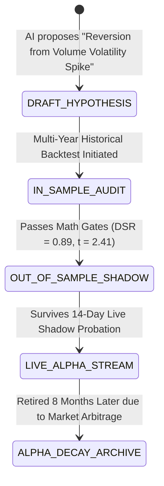

# Autonomous AI Factor Discovery & FSM Research Loop: A Simplified Guide

The **Autonomous AI Factor Discovery & FSM Research Loop** is an algorithmic engine designed to act as your tireless, 24/7 **Senior Quantitative Researcher & Risk Manager**. Instead of humans spending weeks brainstorming mathematical trading formulas, backtesting them, and monitoring them for degradation, this system automates the entire lifecycle.

---

## 1. What is it? (The "Autopilot Quant Lab" Analogy)

Imagine running a high-end quantitative hedge fund. You need a continuous assembly line of new trading ideas because existing strategies eventually stop working when too many market participants discover them (a phenomenon called **Alpha Decay**).

In our platform, this loop (defined in [tasks.py](file:///c:/Users/Vipul%20Gorana/Desktop/Config%20Manager/Dummy/backend/app/worker/tasks.py#L546-L588)) handles two critical jobs autonomously:
1. **The Researcher (AI Alpha Discovery)**: Whenever your active vault of validated trading strategies drops below a healthy operational threshold ($<5$ strategies), the system automatically prompts Google Gemini AI ([ai_analyst_service.py](file:///c:/Users/Vipul%20Gorana/Desktop/Config%20Manager/Dummy/backend/app/services/ai_analyst_service.py#L433-L477)) to invent fresh, mathematically sound alpha formulas with valid economic explanations.
2. **The Auditor & Risk Manager (FSM Lifecycle Engine)**: A Finite State Machine (FSM) relentlessly backtests these ideas against multi-year historical stock data, promotes the profitable ones to live trading, and ruthlessly shuts down degrading strategies before they lose real capital.

---

## 2. How It Helps Us & Expected Outcomes

### Key Benefits
* **Eliminates Human Bias & Fatigue**: Human quants tend to recycle familiar indicators (like simple RSI or moving average crossovers). The autonomous AI combines mathematical operators (`rank`, `delta`, `volatility`, `close`, `volume`) in orthogonal (non-overlapping) ways to uncover hidden structural anomalies.
* **Protection Against False Flukes (Data Mining Bias)**: If you test 100 random formulas, a few will look profitable purely by accident. Our loop applies institutional mathematical filters—specifically the **Deflated Sharpe Ratio ($DSR$)** and **Student-$t$ Statistics**—to weed out statistical flukes and prove genuine predictability.
* **Automated Capital Preservation**: Market regimes shift. Instead of waiting for a manual portfolio review while losses accumulate, the automated loop identifies trailing performance degradation and retires fading strategies automatically.

### Expected Business Outcomes
* A resilient, self-healing repository of **at least 5 mathematically independent, statistically validated trading strategies** ready for live NIFTY 500 execution at all times.
* Zero maintenance overhead in researching new alpha signals or decommissioning broken ones.

---

## 3. Step-by-Step Real-World Example

Let us follow a specific strategy born inside the system through its complete lifecycle:

### Phase 1: Inception (`DRAFT_HYPOTHESIS`)
During its scheduled run, the worker detects that only 3 active strategies are currently deployed. It injects recently failed ideas as a "what to avoid" blacklist and prompts Gemini AI for a new proposal:
* **Proposed Formula**: `rank(-volatility(volume, 10)) * rank(delta(close, 5))`
* **Strategy Name**: *"Reversion from Volume Volatility Spike"*
* **Economic Rationale (`BEHAVIORAL`)**: When retail trading volume becomes unusually volatile over a 2-week window accompanied by short-term price drawdowns, retail panic selling is likely exhausted. Institutional capital stepping in creates an explosive 5-day mean reversion bounce.

### Phase 2: Trial by Fire (`IN_SAMPLE_AUDIT` to `OUT_OF_SAMPLE_SHADOW`)
Within seconds of creation, the backtest engine runs this equation across 3 years of historical NIFTY 500 daily price/volume data:
* **Raw Sharpe Ratio**: `1.72`
* **Deflated Sharpe Ratio ($DSR$)**: `0.89` *(Exceeds our strict $\ge 0.85$ institutional threshold)*
* **Student-$t$ Statistic**: `2.41` *(Exceeds the 95% confidence threshold of $\ge 1.96$)*
* **Outcome**: Because it passed all statistical rigor gates, the system automatically promotes it to `OUT_OF_SAMPLE_SHADOW`. It now runs in the background on daily incoming market bars for a 2-week probation period without risking real capital to verify it wasn't just curve-fitted to old data.

### Phase 3: Live Production (`LIVE_ALPHA_STREAM`)
Having sustained its performance through shadow probation, the strategy promotes to `LIVE_ALPHA_STREAM`. Its daily output signals now actively feed into our momentum scorecards and quantitative portfolio construction modules.

### Phase 4: Graceful Retirement (`ALPHA_DECAY_ARCHIVE`)
Eight months later, major Indian institutional funds adopt similar volatility-reversion algorithms, competing away the pricing efficiency. The strategy's trailing Sharpe Ratio drops to `0.35`. During the nightly evaluation loop, the FSM detects this degradation and demotes the strategy to `ALPHA_DECAY_ARCHIVE`, protecting portfolio equity from ongoing losses.

---

## 4. Why Does It Run Once Daily Instead of Every Minute or Hour?

The schedule is set to **Every 24 Hours (`86400.0` seconds)** in [celery_app.py](file:///c:/Users/Vipul%20Gorana/Desktop/Config%20Manager/Dummy/backend/app/worker/celery_app.py#L48-L51) for three fundamental quantitative and structural reasons:

### A. Market Data Refresh Mechanics (Overnight Bhavcopy)
Our quantitative research models rely heavily on official exchange daily closing snapshots (**NSE Bhavcopy**, delivery volumes, corporate event calendars, and institutional surveillance watchlists). The National Stock Exchange formally consolidates and releases these high-integrity datasets **only once per day after market close** (typically around 6:00 PM IST). 
* *Running the loop every minute or hour during the day would re-analyze the exact same historical candlestick data repeatedly, yielding identical statistical results while wasting computing power.*

### B. Multi-Day Holding Horizons (Macro vs. Microstructure Noise)
As configured in our AI generator ([ai_analyst_service.py:L460](file:///c:/Users/Vipul%20Gorana/Desktop/Config%20Manager/Dummy/backend/app/services/ai_analyst_service.py#L460)), the generated quantitative strategies are designed for a **5-day holding horizon** (`holding_horizon_days = 5`), aiming to capture institutional swing momentum rather than split-second high-frequency arbitrage. 
* *Evaluating multi-day alpha decay or Sharpe statistics on a 1-minute chart introduces deceptive market noise, bid-ask spreads, and liquidity jitter. Daily evaluation perfectly matches the strategy's operational holding horizon.*

### C. Computational & API Resource Optimization
Conducting rigorous Deflated Sharpe audits across 500 individual equities over 3+ years of trading history—combined with querying advanced Generative AI reasoning LLMs—is computationally intense.
* *By adopting a nightly scheduled batch workflow (standard practice among tier-1 quantitative asset management firms like Two Sigma, D.E. Shaw, or AQR), our servers crunch simulations while the market sleeps, presenting validated, ready-to-trade factor portfolios before the 9:15 AM IST market opening bell.*

> [!TIP]
> **On-Demand Override Available**: Although automated batch research executes on a strict 24-hour cycle, you are never locked out! You can instantly fire the factor discovery loop at any moment for testing, debugging, or live demos by clicking **"Deploy Now"** on your new `/schedules` surveillance screen or **"Deploy Gemini Quant Agent"** in the `/research` Laboratory!
