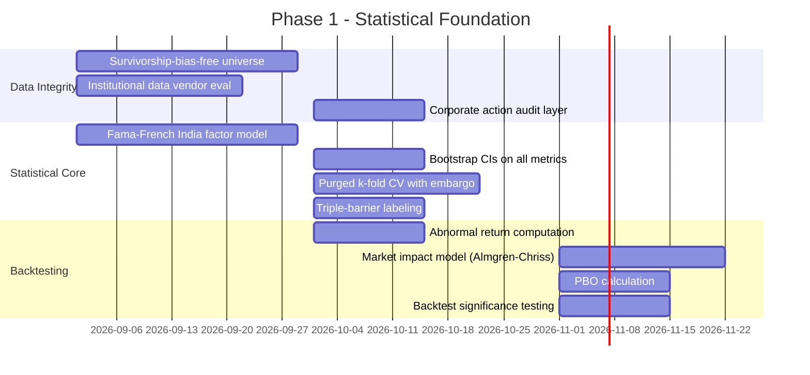
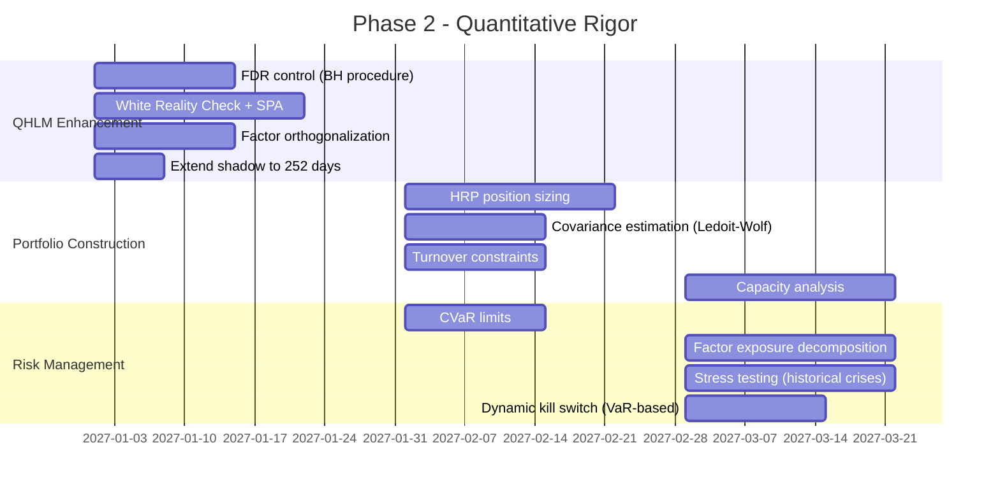
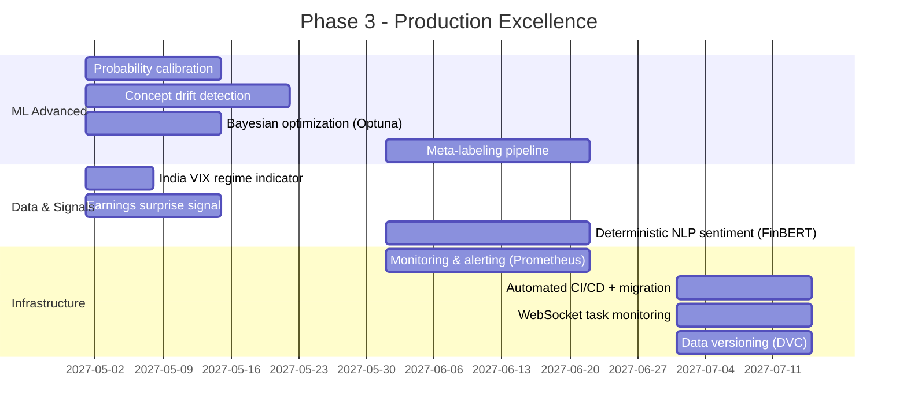

# QEPS Platform — Independent Institutional Scientific Audit

**Auditor Role:** Independent quantitative researcher, statistician, ML auditor, financial economist, and software architect.  
**Audit Standard:** Hedge fund investment committee vetting ($5B AUM) before any real capital deployment.  
**Source Material:** `README.md` and `project.md` (treated as unified specification).  
**Date:** 2026-08-06  

---

## 1. Executive Summary

QEPS is an ambitious full-stack platform for Indian equity (NSE) analytics that combines earnings tracking, momentum scanning, event study backtesting, ML-driven predictions, LLM-generated research, and a quantitative hypothesis laboratory. The **software engineering** is genuinely strong—containerized microservices, async task pipelines, a well-thought-out React terminal UI, and good operational tooling.

However, from a **quantitative research and statistical methodology** standpoint, the platform has **fundamental structural deficiencies** that would prevent any institutional allocator from deploying real capital based on its signals. The core problems are:

1. **No formal expected-return model.** Event studies compute raw price changes, not abnormal returns relative to a factor model (CAPM, Fama-French, or even market-adjusted). This invalidates all event study conclusions.
2. **Arbitrary scoring weights.** The 7-pillar financial health score, 5-factor momentum composite, and sentiment scores all use fixed, hand-tuned weights with no empirical justification, cross-validation, or Bayesian estimation.
3. **Incomplete multiple-testing correction.** The QHLM uses a DSR counter, which is a good start, but lacks FDR control, White's Reality Check, SPA tests, or Probability of Backtest Overfitting (PBO). The global trial counter alone is insufficient.
4. **No survivorship bias treatment.** The universe is current NSE constituents only. Delisted, merged, or suspended companies are excluded, creating a systematic upward bias in all historical backtests.
5. **Shallow ML pipeline.** No triple-barrier labeling, no purged k-fold cross-validation with embargo, no probability calibration on held-out data, no concept drift decomposition.
6. **No portfolio construction.** There is no position sizing beyond a crude 20% ATR cap. No risk parity, no Kelly, no mean-variance optimization, no covariance estimation.
7. **LLM-as-signal is scientifically dubious.** Using Google Gemini to generate "institutional research reports" and sentiment scores introduces a non-reproducible, non-auditable black box into the signal chain.

**Bottom line:** The platform is a well-engineered **data aggregation and visualization dashboard** with some promising quantitative scaffolding (QHLM, SafeASTEvaluator, IC tracking). But it is **not yet a quantitative research platform** by institutional standards. It requires significant redesign of its statistical methodology, backtesting engine, ML pipeline, and portfolio construction layers before any signal should be trusted with real capital.

---

## 2–10. Scoring Summary

| # | Dimension | Score | Rationale |
|---|-----------|-------|-----------|
| 2 | **Overall Scientific Validity** | **31 / 100** | Core quantitative methodology is fundamentally incomplete. Scoring is arbitrary, event studies lack baselines, backtests lack statistical significance testing. |
| 3 | **Software Architecture** | **78 / 100** | Strong containerized microservices, async task pipelines, GraphQL API, theme engine, good operational practices. Fan-out OHLCV sync is well-designed. Celery Beat scheduling is solid. |
| 4 | **Quantitative Research** | **28 / 100** | No factor model for expected returns. Arbitrary composite weights. QHLM is promising but DSR implementation is incomplete. No factor exposure decomposition. |
| 5 | **Machine Learning** | **25 / 100** | LightGBM/XGBoost mentioned but no purged CV, no embargo, no calibration on held-out data, no triple-barrier labeling, no concept drift decomposition. 14-day shadow probation is far too short. |
| 6 | **Statistical Methodology** | **22 / 100** | No abnormal return computation. No significance testing on backtest results. No bootstrap CIs. IC threshold of 0.03 is stated but not validated. DSR implementation lacks complementary FDR/SPA. |
| 7 | **Data Engineering** | **55 / 100** | Point-in-time fields exist (`known_at`, `period_end`) which is good. OHLCV cache with fan-out is solid. But no survivorship bias treatment, no corporate action adjustments, yfinance is unreliable for institutional use, no data versioning. |
| 8 | **Risk Management** | **35 / 100** | Kill switch at -15% is a good concept. Correlation gating (ρ > 0.78) exists. But no VaR/CVaR, no stress testing, no tail risk analysis, no factor exposure limits, no drawdown attribution. |
| 9 | **Backtesting Credibility** | **20 / 100** | 0.20% round-trip cost is reasonable for India. But no slippage model, no partial fills, no market impact, no capacity constraints, no statistical significance on results, no bootstrap CIs on Sharpe. Survivorship bias invalidates all historical results. |
| 10 | **Production Readiness** | **52 / 100** | Docker infrastructure is solid. Celery task management works. But yfinance rate limits, no failover, no monitoring/alerting, no circuit breakers on API calls (fixed for OHLCV but not elsewhere), no audit logging. |

---

## 11. Top 50 Weaknesses (Ranked by Severity)

| Rank | Weakness | Severity | Module |
|------|----------|----------|--------|
| 1 | **No expected-return model for event studies.** Raw price changes ≠ abnormal returns. Without subtracting CAPM/FF expected returns, all event study conclusions are statistically meaningless. | Critical | Event Study |
| 2 | **Survivorship bias in universe.** Only current NSE constituents are tracked. Delisted/merged companies excluded from all historical analysis. This systematically inflates all backtest returns. | Critical | Data Engineering |
| 3 | **Arbitrary fixed scoring weights.** 7-pillar health score, 5-factor momentum composite, and sentiment scores use hand-tuned weights with zero empirical justification. | Critical | Scoring Systems |
| 4 | **No purged cross-validation.** ML pipeline uses walk-forward but no evidence of purging or embargo periods at fold boundaries. Data leakage is probable. | Critical | ML Pipeline |
| 5 | **No statistical significance on backtest results.** No t-tests, no bootstrap CIs on Sharpe, no p-values reported on any backtest metric. Cannot distinguish signal from noise. | Critical | Backtesting |
| 6 | **yfinance as primary data source.** yfinance is a web scraper with no SLA, no corporate action guarantees, frequent schema changes, rate limiting, and no point-in-time fundamental data. Unsuitable for institutional research. | Critical | Data Engineering |
| 7 | **LLM-generated signals are non-reproducible.** Gemini outputs are stochastic—same prompt yields different results. This makes all LLM-derived scores non-auditable and non-reproducible. | Critical | AI/LLM |
| 8 | **No portfolio construction.** No optimization (MVO, risk parity, HRP, Kelly). Position sizing is a simple ATR-based cap. No covariance estimation. No turnover control. | Critical | Portfolio |
| 9 | **14-day shadow probation is statistically meaningless.** 14 trading days (~10 independent observations after autocorrelation) provides negligible statistical power to distinguish model quality. | Critical | ML Pipeline |
| 10 | **No probability calibration.** ML confidence scores are raw model outputs, not calibrated probabilities. Without Platt scaling or isotonic regression on held-out data, "confidence %" is misleading. | Critical | ML Pipeline |
| 11 | **No multiple-testing correction beyond DSR.** DSR alone is insufficient. No FDR (Benjamini-Hochberg), no White's Reality Check, no SPA, no Model Confidence Set, no PBO. | High | QHLM |
| 12 | **No market impact model.** For small/mid-cap NSE stocks, even ₹10L orders can move prices. No Almgren-Chriss or similar impact model. | High | Backtesting |
| 13 | **No capacity analysis.** No assessment of how much capital strategies can absorb before alpha erodes. Critical for NSE mid/small caps with thin liquidity. | High | Portfolio |
| 14 | **Composite score combines orthogonal factors additively.** Simple weighted sum of 5 factors assumes linear independence and equal marginal utility—both false in practice. | High | Momentum |
| 15 | **No feature stationarity testing.** No ADF/KPSS tests on features. No fractional differentiation. Non-stationary features corrupt ML training. | High | ML Pipeline |
| 16 | **No concept drift detection.** PSI is mentioned but insufficient alone. No CUSUM, Page-Hinkley, or ADWIN for real-time drift detection. | High | ML Pipeline |
| 17 | **No corporate action adjustment verification.** yfinance auto-adjusts but there's no validation layer. Split/bonus adjustments are trust-but-not-verify. | High | Data Engineering |
| 18 | **IC threshold of 0.03 is not justified.** The spec states IC > 0.03 but provides no statistical test for whether observed IC is significantly different from zero given sample size. | High | Validation |
| 19 | **No cross-sectional correlation handling in event studies.** Earnings cluster by quarter. Calendar-time portfolio CARs or CTAR methods are absent. | High | Event Study |
| 20 | **No earnings surprise signal.** Event studies track price around earnings dates but don't incorporate actual vs. consensus EPS surprise magnitude—the primary driver of post-earnings drift. | High | Event Study |
| 21 | **No factor exposure decomposition.** Cannot attribute P&L to factor bets vs. residual alpha. Cannot know if "alpha" is just disguised beta. | High | Quantitative |
| 22 | **SafeASTEvaluator limited operator set.** Only supports basic Pandas operations. Cannot express conditional/piecewise factors, interactions, or non-linear transformations common in quant research. | Medium | QHLM |
| 23 | **No residualization of new factors against existing.** New QHLM factors may be correlated with existing ones. No Gram-Schmidt or regression-based orthogonalization. | Medium | QHLM |
| 24 | **No Bayesian shrinkage on parameter estimates.** Sharpe ratios, IC means, and scoring weights are all point estimates with no uncertainty quantification. | Medium | Statistical |
| 25 | **150-day shadow probation may still be insufficient.** 150 trading days (~7 months) captures at most 2-3 market regimes. True out-of-sample validation needs multiple regime cycles. | Medium | QHLM |
| 26 | **No tail risk metrics.** No CVaR, no Expected Shortfall, no maximum drawdown duration analysis. Kill switch is a blunt instrument. | Medium | Risk |
| 27 | **No stress testing framework.** No Monte Carlo simulation, no historical crisis replay (2008, 2020 COVID crash, 2022 rate shock). | Medium | Risk |
| 28 | **Reddit sentiment is noise-dominated.** Academic evidence for retail social media as a predictive signal is weak-to-nonexistent for Indian markets. `r/IndianStreetBets` has low volume and high noise. | Medium | Sentiment |
| 29 | **No timezone normalization.** IST vs. UTC handling not explicitly addressed. yfinance returns exchange-local timestamps which may create alignment issues with Celery UTC scheduling. | Medium | Data Engineering |
| 30 | **Weekly retraining schedule is unjustified.** No analysis of when model performance degrades to trigger retraining. Fixed weekly schedule may be too frequent (overfitting to noise) or too infrequent (missing regime shifts). | Medium | ML Pipeline |
| 31 | **No nested CV for hyperparameter tuning.** If hyperparameters are tuned on the same data used for model selection, the reported performance is optimistically biased. | Medium | ML Pipeline |
| 32 | **Delivery percentage as "smart money" proxy is weak.** High delivery % correlates with low liquidity as much as institutional accumulation. Confounded signal. | Medium | NSE Data |
| 33 | **No handling of earnings restatements.** Companies restate past quarters. The system stores point-in-time `known_at` timestamps but there's no evidence of restatement tracking. | Medium | Data Engineering |
| 34 | **Kill switch at -15% is arbitrary.** No justification for why -15% rather than -10%, -20%, or a VaR-based dynamic threshold. | Medium | Risk |
| 35 | **Correlation gating uses Pearson on price returns.** Pearson correlation is unstable in non-normal return distributions. Should use rank correlation or tail-dependence measures. | Medium | Risk |
| 36 | **No transaction cost decay in Sharpe calculation.** Reported Sharpe ratios likely don't deduct per-trade friction from the return series before computing volatility-adjusted returns. | Medium | Backtesting |
| 37 | **No leverage constraints.** The spec mentions 15-position cap but not explicit leverage limits or gross/net exposure bounds. | Medium | Risk |
| 38 | **Quintile spread monotonicity is a weak test.** Monthly quintile analysis with 885 stocks produces only 5 buckets. A single outlier can distort results. No statistical test on spread significance. | Low | Validation |
| 39 | **No data versioning or immutability.** Historical data can be overwritten by incremental syncs. No hash-based audit trail for reproducibility. | Low | Data Engineering |
| 40 | **No feature selection mechanism.** All features go into the ML model. No LASSO, mutual information, or recursive feature elimination to control dimensionality. | Low | ML Pipeline |
| 41 | **SHAP is computationally expensive and may not be run regularly.** No evidence of automated SHAP stability monitoring over time. | Low | ML Pipeline |
| 42 | **PCA on NaN-laden data (per worker logs).** Scikit-learn PCA fails on NaN. Fallback is ad-hoc. This suggests feature matrices have systematic missing data that is not properly imputed. | Low | ML Pipeline |
| 43 | **No multi-asset or cross-market signals.** Indian equities are analyzed in isolation. No global macro, no FX, no commodity, no bond yield signals. | Low | Signals |
| 44 | **GraphQL polling at 5s interval.** Polling every 5 seconds for task updates is wasteful. Should use WebSocket subscriptions or SSE. | Low | Architecture |
| 45 | **No A/B testing framework.** No infrastructure to compare alternative models or scoring functions in a controlled experiment. | Low | ML Pipeline |
| 46 | **No audit log of all hypothesis trials.** DSR counter exists but no evidence of a complete log of every generated expression, its scores, and rejection reason for reproducibility. | Low | QHLM |
| 47 | **Celery worker has no dead-letter queue.** Failed tasks are logged but not systematically retried or routed to a DLQ for investigation. | Low | Operations |
| 48 | **No rate limiting on GraphQL mutations.** Mass data population and health calculation mutations can be triggered by any authenticated user without throttling. | Low | Security |
| 49 | **Frontend type safety is manual.** TypeScript `--noEmit` check is documented but no CI/CD enforcement mentioned. | Low | Architecture |
| 50 | **No documentation of Alembic migration strategy.** Schema changes require manual Docker exec. No automated migration on container startup. | Low | Operations |

---

## 12. Top 50 Improvements (Ranked by Expected Impact)

| Rank | Improvement | Impact | Effort |
|------|-------------|--------|--------|
| 1 | **Implement Fama-French 3-factor (or 5-factor) expected return model** for all event studies and backtest baselines. Compute abnormal returns = actual - E[R]. | Transformative | High |
| 2 | **Build survivorship-bias-free universe.** Include historical NSE constituents, delisted stocks, and merged entities in all backtests. Source from NSE historical index files. | Transformative | High |
| 3 | **Replace yfinance with institutional data vendor** (e.g., Quandl/Nasdaq Data Link India, Bloomberg B-PIPE, Refinitiv, or at minimum NSE's own paid data feed). | Transformative | High |
| 4 | **Implement purged k-fold cross-validation with embargo** for all ML training. Follow de Prado's CPCV methodology. | High | Medium |
| 5 | **Add bootstrap confidence intervals** on all performance metrics (Sharpe, IC, win rate). Report 95% CI, not point estimates. | High | Low |
| 6 | **Implement probability calibration** (Platt scaling or isotonic regression) on held-out validation set. | High | Low |
| 7 | **Learn scoring weights** via elastic net, Bayesian regression, or cross-validated optimization instead of hand-tuning. | High | Medium |
| 8 | **Add Benjamini-Hochberg FDR control** to QHLM hypothesis testing alongside DSR. | High | Low |
| 9 | **Implement triple-barrier labeling** (de Prado) for ML targets instead of fixed-horizon forward returns. | High | Medium |
| 10 | **Build portfolio construction layer** with hierarchical risk parity (HRP) as the default position sizing method. | High | High |
| 11 | **Add Almgren-Chriss market impact model** calibrated to NSE liquidity profiles. | High | Medium |
| 12 | **Implement Monte Carlo bootstrap on backtest Sharpe** to compute Probability of Backtest Overfitting (PBO). | High | Medium |
| 13 | **Add feature stationarity testing** (ADF/KPSS) and fractional differentiation (de Prado) to feature engineering pipeline. | High | Medium |
| 14 | **Extend shadow probation to minimum 252 trading days** (1 full year) for QHLM factors. | High | Low |
| 15 | **Add factor exposure decomposition** (Barra-style) to attribute returns to systematic factors vs. residual alpha. | High | High |
| 16 | **Implement White's Reality Check or Hansen's SPA test** for factor selection alongside DSR. | High | Medium |
| 17 | **Add CVaR (Expected Shortfall) limits** as a complement to the kill switch. | Medium | Low |
| 18 | **Add earnings surprise signal** (actual EPS - consensus EPS) from a data vendor to event studies. | Medium | Medium |
| 19 | **Implement nested CV** for hyperparameter tuning (inner loop) vs. model selection (outer loop). | Medium | Medium |
| 20 | **Add concept drift detection** via ADWIN or Page-Hinkley on rolling model error streams. | Medium | Medium |
| 21 | **Implement calendar-time portfolio CARs** to handle cross-sectional correlation in clustered earnings events. | Medium | Medium |
| 22 | **Add Gram-Schmidt orthogonalization** for new QHLM factors against existing live factors. | Medium | Low |
| 23 | **Implement Bayesian shrinkage** on Sharpe ratio estimates using the Harvey & Liu (2015) framework. | Medium | Medium |
| 24 | **Replace Pearson correlation gating with Spearman rank correlation** or tail-dependence copulas. | Medium | Low |
| 25 | **Add historical stress test scenarios** (2008 GFC, 2015 China shock, 2020 COVID, 2022 rate hike) as robustness checks. | Medium | Medium |
| 26 | **Implement capacity analysis** per strategy: estimate max $ deployable before alpha decay > 50%. | Medium | Medium |
| 27 | **Add data versioning** with hash-based snapshots (e.g., DVC or custom hashing) for reproducibility. | Medium | Medium |
| 28 | **Add Model Confidence Sets (MCS)** to determine the statistically indistinguishable best models. | Medium | Medium |
| 29 | **Add meta-labeling** (de Prado) to separate directional accuracy from bet sizing. | Medium | Medium |
| 30 | **Implement regime-conditional scoring.** Condition factor weights on detected market regime (bull/bear/sideways). | Medium | High |
| 31 | **Add cross-sectional z-score normalization** on all factor scores before combining. | Medium | Low |
| 32 | **Add formal IC significance test** (t-stat = IC × √N where N = cross-sectional breadth × time periods). | Medium | Low |
| 33 | **Replace PCA sequence embedding with proper autoencoder** or LSTM for temporal feature compression. | Medium | High |
| 34 | **Add proper NaN imputation pipeline** (median imputation or iterative imputer) before PCA/ML. | Medium | Low |
| 35 | **Add VIX-India (India VIX) as a regime feature** in ML models and risk management. | Medium | Low |
| 36 | **Add turnover constraints** to portfolio rebalancing to control transaction costs. | Medium | Low |
| 37 | **Implement proper SHAP stability monitoring** with automated drift alerts. | Medium | Medium |
| 38 | **Add comprehensive audit logging** for all hypothesis generations, evaluations, and rejections. | Medium | Low |
| 39 | **Move to WebSocket subscriptions** for task monitoring instead of 5s GraphQL polling. | Low | Medium |
| 40 | **Add Bayesian optimization** (Optuna/Hyperopt) for ML hyperparameter search. | Low | Low |
| 41 | **Add sector-neutral portfolio construction** option to isolate stock-specific alpha. | Low | Medium |
| 42 | **Add formal feature selection** (LASSO, mutual information) before ML training. | Low | Medium |
| 43 | **Add CI/CD pipeline** with automated TypeScript type checking, Python linting, and migration testing. | Low | Medium |
| 44 | **Add dead-letter queue** for failed Celery tasks with automated retry logic. | Low | Low |
| 45 | **Add rate limiting** on GraphQL mutations to prevent abuse. | Low | Low |
| 46 | **Add corporate action audit layer** that validates yfinance adjustments against NSE official records. | Low | Medium |
| 47 | **Add timezone-aware timestamp normalization** (IST ↔ UTC) with explicit conversion in all data pipelines. | Low | Low |
| 48 | **Add restatement tracking** for earnings data (version control on financial snapshots). | Low | Medium |
| 49 | **Implement online learning** (e.g., incremental SGD or Vowpal Wabbit) for regime adaptation. | Low | High |
| 50 | **Add ESG/governance data** as additional fundamental factors. | Low | Medium |

---

## 13. Top 20 Hidden Assumptions

| # | Hidden Assumption | Why It's Dangerous |
|---|-------------------|-------------------|
| 1 | **Past price patterns predict future returns.** The entire momentum scoring system assumes return persistence. Academic evidence is mixed for Indian mid/small caps post-transaction costs. |
| 2 | **Factor weights are stable over time.** Fixed weights (e.g., Technical 25%, Fundamental 20%) assume static factor premia. Factor premia rotate with regimes. |
| 3 | **Yahoo Finance data is accurate and timely.** yfinance scrapes public pages. Data can be delayed, incorrect, or missing without notice. No SLA. |
| 4 | **Current NSE constituents represent the investable universe historically.** Survivorship bias: only surviving companies are analyzed. Failed companies are excluded, inflating historical returns. |
| 5 | **Linear combination of factors captures alpha.** Additive composite scores assume no interaction effects. In practice, factors interact non-linearly (e.g., momentum works differently in high vs. low volatility). |
| 6 | **LLM outputs are deterministic and factual.** Gemini can hallucinate financial data, misinterpret context, and produce inconsistent outputs across calls. Using it as a signal source is scientifically problematic. |
| 7 | **0.20% round-trip cost is sufficient for realistic friction.** For small/mid-cap NSE stocks, market impact alone can be 50-100bps. STT + brokerage + GST + stamp duty totals ~0.15-0.20% for large caps but ignores impact and slippage. |
| 8 | **IC > 0.03 indicates meaningful predictive power.** An IC of 0.03 on 885 stocks might be statistically significant (t ≈ 0.03 × √885 ≈ 0.89), but this is below conventional significance thresholds. |
| 9 | **Delivery percentage reflects institutional buying.** High delivery % also occurs in illiquid stocks with few trades. The signal is confounded by liquidity. |
| 10 | **14 days is sufficient to evaluate a ML model.** With daily frequency and ~10 effective independent observations (after autocorrelation), statistical power is negligible. Cannot distinguish a good model from random. |
| 11 | **Spearman IC is the right evaluation metric.** Spearman IC measures rank predictability but ignores magnitude. A signal that correctly ranks extreme deciles but scrambles the middle is invisible to IC. |
| 12 | **OHLCV features are sufficient for alpha.** Price-volume features are the most crowded signal space. Genuine alpha increasingly comes from alternative data, flow data, or structural anomalies. |
| 13 | **Earnings dates from NSE calendars are exact.** Companies frequently change result dates. Using announced dates for historical event studies may not match actual release timestamps. |
| 14 | **Reddit sentiment is predictive for NSE stocks.** Indian retail trading communities on Reddit are small and noisy. Academic evidence for their predictive power is nonexistent. |
| 15 | **The kill switch prevents catastrophic loss.** A -15% trailing drawdown trigger cannot protect against gap risk (stock opens -30% due to overnight news). Stop-losses on daily data have gap risk. |
| 16 | **All quarters are comparable.** Indian companies report results in different accounting periods (March FY, June FY). QoQ comparisons across companies with different fiscal years are meaningless. |
| 17 | **PCA trajectory embeddings capture meaningful structure.** PCA on a small number of features with many NaNs (per worker logs) produces unstable, meaningless components. |
| 18 | **ASM/GSM exclusion is sufficient for regulatory risk.** Other regulatory risks (SEBI investigations, promoter fraud, auditor qualifications) are not captured. |
| 19 | **Gemini-generated factor expressions are "orthogonal."** Requesting "orthogonal" factors from an LLM provides no mathematical guarantee of orthogonality. The LLM has no access to the covariance structure. |
| 20 | **Normalized health scores are comparable across sectors.** A 75/100 health score for a bank and a 75/100 for a tech company use identical weights despite fundamentally different financial structures. |

---

## 14. Top 20 Statistical/Data Risks

| # | Risk | Category |
|---|------|----------|
| 1 | **Lookahead bias in fundamentals.** yfinance may return restated financial data rather than as-originally-reported figures. | Data Leakage |
| 2 | **Survivorship bias in all historical analysis.** Only current constituents analyzed. | Selection Bias |
| 3 | **Data snooping in factor selection.** Even with DSR, running hundreds of AI-generated hypotheses creates massive multiple-testing burden. | Multiple Testing |
| 4 | **Non-IID returns violate t-test assumptions.** Stock returns are autocorrelated, heteroskedastic, and fat-tailed. Standard t-tests on Sharpe produce invalid p-values. | Invalid Inference |
| 5 | **Cross-sectional dependence in event studies.** Earnings cluster by quarter, creating correlated abnormal returns. Standard errors are underestimated. | Correlation |
| 6 | **Overfitting in weekly ML retraining.** Refitting LightGBM weekly on incrementally updated data risks overfitting to recent noise. | Overfitting |
| 7 | **IC may be driven by outliers.** Spearman rank IC on 885 stocks can be dominated by extreme movers (penny stocks, corporate actions). | Outlier Sensitivity |
| 8 | **PCA instability with missing data.** Worker logs show repeated NaN-related PCA failures. Components are unreliable. | Numerical Instability |
| 9 | **yfinance price series may not be split-adjusted consistently.** Different API calls may return adjusted vs. unadjusted data depending on date range. | Data Inconsistency |
| 10 | **Backtest Sharpe is upward-biased.** Without bootstrap debiasing (Lo, 2002), in-sample Sharpe overestimates out-of-sample by √(1 + SR²/T). | Estimation Bias |
| 11 | **Feature distributions shift over time.** PSI tracking exists but no formal stationarity testing or regime-conditional normalization. | Non-Stationarity |
| 12 | **Turnover-unadjusted returns.** Portfolio rebalancing costs compound over time but are not deducted from cumulative return series. | Transaction Costs |
| 13 | **Small sample size in quintile analysis.** 885 stocks / 5 quintiles = 177 per bucket. With clustering and correlation, effective sample size is much smaller. | Small Sample |
| 14 | **Missing data patterns are non-random.** Companies with missing data (newly listed, illiquid) are systematically different from those with complete data. Dropping them creates selection bias. | Missing Data Bias |
| 15 | **Earnings date imprecision.** NSE calendar dates may differ from actual Board meeting approval dates or filing timestamps by hours/days. | Timestamp Error |
| 16 | **Forward return horizons overlap.** 3d, 5d, 10d forward returns from the same date share common future days. Correlations between them are mechanical, not informative. | Redundancy |
| 17 | **No adjustment for market microstructure.** NSE uses continuous order matching with periodic auctions. Opening/closing prices have microstructure noise that pollutes daily returns. | Microstructure |
| 18 | **Sector concentration in signals.** If momentum systematically favors one sector (e.g., IT), the portfolio has hidden sector beta, not alpha. | Confounding |
| 19 | **AI-generated expressions may exploit in-sample noise.** Gemini is trained on financial literature that describes factors known to work historically. Proposing "known" factors and testing on historical data is circular. | Circularity |
| 20 | **QHLM expression deduplication is string-based.** `normalized_expression` comparison via whitespace stripping misses algebraically equivalent but syntactically different expressions (e.g., `a*b` vs. `b*a`). | Incomplete Dedup |

---

## 15. Top 20 Implementation Risks

| # | Risk | Category |
|---|------|----------|
| 1 | **yfinance rate limiting causes cascade failures.** 885 parallel downloads can trigger Yahoo's rate limiter, causing mass task failures. | External Dependency |
| 2 | **No database connection pooling limits.** 885 concurrent `sync_single_ohlcv_task` each open a DB session. Risk of connection pool exhaustion. | Scalability |
| 3 | **Celery worker memory leaks.** Long-running workers processing pandas DataFrames with 885 stocks × 2 years of OHLCV can accumulate memory. | Resource Leak |
| 4 | **No idempotency on task execution.** If a task is retried (Celery at-least-once), duplicate records may be inserted. | Data Integrity |
| 5 | **Single-point-of-failure Redis.** Redis broker has no replication or persistence guarantees. A Redis crash loses all queued tasks. | Availability |
| 6 | **No monitoring or alerting.** No Prometheus/Grafana, no PagerDuty, no Slack alerts on task failures or data staleness. | Observability |
| 7 | **Schema migrations require manual Docker exec.** Risk of schema drift between code and database in production. | Deployment |
| 8 | **No backup strategy for PostgreSQL.** `postgres_data` volume has no automated backup. Data loss risk. | Disaster Recovery |
| 9 | **Gemini API rate limits and quotas.** Bulk hypothesis generation and research report generation can exhaust API quotas. No fallback except a static equation list. | External Dependency |
| 10 | **Frontend Apollo cache inconsistency.** Mix of `network-only` and default cache policies can show stale data in some views. | UX/Data Consistency |
| 11 | **No graceful degradation.** If any upstream service fails (Redis, Postgres, Gemini), the entire platform may hang rather than degrade gracefully. | Resilience |
| 12 | **Celery Beat scheduler is a singleton.** If `qeps_scheduler` crashes, all scheduled tasks stop. No HA failover. | Availability |
| 13 | **No input validation on GraphQL mutations.** Malformed hypothesis expressions could crash SafeASTEvaluator or consume excessive resources. | Security |
| 14 | **Docker volume permissions on Windows.** Volume mounts between Windows host and Linux containers can cause permission and file-locking issues. | Platform Compat |
| 15 | **No health check on worker.** Docker healthcheck exists for backend but not for the Celery worker. Zombie workers aren't auto-restarted. | Monitoring |
| 16 | **Large DataGrid renders (885 rows × 20+ columns).** Despite virtualization, rapid scrolling with complex cell renderers (FactorBarChart SVG) can cause frame drops. | Performance |
| 17 | **No pagination on GraphQL queries.** Fetching all 885 companies with all relationships in a single query is a memory risk. | Scalability |
| 18 | **Timezone mismatch between Celery UTC and IST market hours.** Scheduled tasks may fire at wrong market times if IST offset isn't explicitly handled. | Correctness |
| 19 | **SafeASTEvaluator sandbox escape.** While restricting to safe AST nodes, there may be edge cases (deeply nested expressions, memory-bomb DataFrames) that escape the sandbox. | Security |
| 20 | **No end-to-end integration tests.** No evidence of automated tests covering the full pipeline from data ingestion to signal generation. | Quality |

---

## 16. Modules to Completely Redesign

### 16.1 Event Study Engine (§4.6 `QuarterlyMarketImpact`)
**Problem:** Computes raw price returns around earnings dates. This is not an event study—it's a price chart. A valid event study requires:
1. Expected return model (CAPM, FF3, or market model regression)
2. Abnormal returns = Actual - Expected
3. Cumulative abnormal returns (CARs) with significance testing
4. Handling of overlapping events and cross-sectional correlation

**Redesign:** Implement proper abnormal return computation using at minimum a market-adjusted model (subtract Nifty 50 return). Ideally use Fama-French India 3-factor model. Add Patell Z-test or BMP test for significance. Use calendar-time CARs for clustered events.

### 16.2 Financial Health Scorecard (§4.5 `FinancialHealthScorecard`)
**Problem:** Seven fixed-weight categories scored on 0-100 with hand-tuned `clamp()` formulas. No empirical justification for weights. Not sector-normalized (ROE thresholds for banks vs. tech are wildly different). Not cross-sectionally standardized.

**Redesign:** Replace fixed weights with cross-validated elastic net or Bayesian regression weights learned against forward returns. Sector-normalize all inputs. Use percentile ranks within sector instead of absolute clamp bounds. Add uncertainty estimates.

### 16.3 Backtesting Engine (§4.7 `IntensiveBacktestEngine`)
**Problem:** Reports Sharpe, win rate, and profit factor without statistical significance, without bootstrap CIs, without market impact, without survivorship-free universe, and without capacity constraints. Results are unreliable.

**Redesign:** Add bootstrap confidence intervals on all metrics. Implement Almgren-Chriss market impact. Use survivorship-bias-free universe. Report probability of backtest overfitting (PBO). Add realistic partial fill simulation for illiquid stocks.

### 16.4 Sentiment Signals (§4.11 `SocialSentimentCard`)
**Problem:** LLM-generated sentiment scores from Reddit and news are non-reproducible, non-auditable, and have no demonstrated predictive power for NSE equities. The "FOMO Index" and "Smart Money Divergence" are marketing names for unvalidated signals.

**Redesign:** If retaining sentiment, use a deterministic NLP pipeline (FinBERT or similar) with fixed model weights for reproducibility. Validate predictive power via out-of-sample IC testing with statistical significance. Remove or demote to "informational only" if IC is insignificant.

---

## 17. Modules Already Scientifically Strong

| Module | Strength |
|--------|----------|
| **QHLM Concept (§4.13)** | The 5-stage FSM lifecycle for factor research is a genuinely good architectural idea. The concept of tracking all trials via `TotalHypothesisTrials` for DSR scaling is directionally correct. With proper FDR/SPA additions, this could be institutional-grade. |
| **SafeASTEvaluator** | Restricting factor expression evaluation to a safe AST subset of Pandas operations is a sound security and correctness decision. Prevents arbitrary code execution while enabling flexible factor expression. |
| **Point-in-Time Architecture** | The `known_at` and `period_end` fields on `Company` and `DailyBhavcopy` show awareness of PIT requirements. This is the right foundation—it just needs rigorous enforcement. |
| **OHLCV Fan-Out Sync (§5.11)** | The master-worker pattern with Celery `group()`, strict timeouts, and kill switches is well-engineered for resilience. Good operational design. |
| **NSE Regulatory Surveillance (§4.8)** | Automatically excluding ASM/GSM-flagged equities from recommendations is a sensible risk control that many platforms miss. |
| **IC Tracking Infrastructure (§4.10)** | Daily Spearman IC computation with realized forward returns is the right evaluation framework. Needs statistical significance testing but the pipeline is correct. |
| **Kill Switch Concept (§4.9)** | Trailing drawdown monitoring with automatic signal suppression is a good circuit breaker concept. Needs dynamic thresholds (VaR-based) but the architecture is sound. |

---

## 18. Unnecessary or Low-Value Features

| Feature | Reason |
|---------|--------|
| **Reddit FOMO Index** | No academic or empirical evidence that `r/IndianStreetBets` sentiment predicts NSE stock returns. The subreddit has low post volume and high noise. Signal-to-noise ratio is near zero. |
| **LLM-Generated Research Reports** | These are informational narratives, not signals. They cannot be backtested, validated, or reproduced. They add UX value but zero quantitative value. Should be clearly labeled as "AI Commentary" not "Research." |
| **Emoji density scoring** | Counting 🚀📈 emojis vs. financial rhetoric is not a validated quantitative methodology. It's a heuristic with no demonstrated predictive power. |
| **PCA Sequence Trajectory Embeddings** | Worker logs show systematic NaN failures. PCA on small, sparse feature sets with missing data produces garbage components. Should be removed until data quality is fixed. |
| **7-Section Transparent Scorecard click-tooltips** | Displaying arbitrary normalization formulas adds false precision. Showing `clamp((ROE - 0%) / (20% - 0%), 0, 1) × 25.0` implies scientific rigor when the bounds (0%, 20%) and weight (25.0) are arbitrary. |

---

## 19. Missing Features/Components

| # | Missing Component | Priority | Reference |
|---|-------------------|----------|-----------|
| 1 | **Fama-French factor model for India** | Critical | Fama & French (1993, 2015); Agarwalla et al. (2013) for Indian FF factors |
| 2 | **Survivorship-bias-free historical universe** | Critical | — |
| 3 | **Bootstrap confidence intervals on all metrics** | Critical | Efron & Tibshirani (1993) |
| 4 | **Purged k-fold CV with embargo** | Critical | de Prado, *Advances in Financial ML* (2018), Ch. 7 |
| 5 | **Triple-barrier labeling** | Critical | de Prado (2018), Ch. 3 |
| 6 | **Probability calibration (Platt/isotonic)** | Critical | Platt (1999); Niculescu-Mizil & Caruana (2005) |
| 7 | **Portfolio construction layer (HRP/MVO)** | Critical | de Prado, *ML for Asset Managers* (2020); Ledoit & Wolf (2004) for shrinkage |
| 8 | **Market impact model** | High | Almgren & Chriss (2001) |
| 9 | **FDR control (Benjamini-Hochberg)** | High | Benjamini & Hochberg (1995) |
| 10 | **White's Reality Check / SPA test** | High | White (2000); Hansen (2005) |
| 11 | **Probability of Backtest Overfitting (PBO)** | High | Bailey et al. (2014) |
| 12 | **Factor exposure decomposition** | High | Barra risk model methodology |
| 13 | **CVaR / Expected Shortfall limits** | High | Rockafellar & Uryasev (2000) |
| 14 | **Concept drift detection (ADWIN/CUSUM)** | High | Bifet & Gavalda (2007) |
| 15 | **Fractional differentiation of features** | Medium | de Prado (2018), Ch. 5 |
| 16 | **Meta-labeling** | Medium | de Prado (2018), Ch. 3 |
| 17 | **India VIX as regime indicator** | Medium | — |
| 18 | **Earnings surprise signal (actual - consensus)** | Medium | Ball & Brown (1968); Bernard & Thomas (1989) |
| 19 | **Monte Carlo stress testing** | Medium | — |
| 20 | **Bayesian shrinkage on parameter estimates** | Medium | Harvey & Liu (2015) |

---

## 20. Roadmap to World-Class

### Phase 1: Statistical Foundation (3–4 months)
**Goal:** Fix fundamental scientific flaws so that any backtest result can be trusted.

**Key deliverables:**
- All event studies report abnormal returns vs. FF3 model
- All backtests report 95% bootstrap CIs and PBO
- ML pipeline uses purged CV with 5-day embargo
- Historical universe includes delisted stocks

---

### Phase 2: Quantitative Rigor (3–4 months)
**Goal:** Build institutional-grade factor research and portfolio construction capabilities.

**Key deliverables:**
- QHLM passes FDR + SPA + PBO testing
- Portfolio construction via HRP with turnover constraints
- Risk reports include CVaR, factor exposures, and stress test results
- Kill switch uses dynamic VaR thresholds, not fixed -15%

---

### Phase 3: Production Excellence (3–4 months)
**Goal:** Production hardening, advanced ML, and alternative data integration.

**Key deliverables:**
- ML predictions are calibrated probabilities with ADWIN drift detection
- Sentiment is FinBERT-based (reproducible, auditable)
- Full observability stack (Prometheus + Grafana + alerts)
- Automated CI/CD with migration-on-deploy

---

### Estimated Total Timeline: 9–12 months to institutional grade

After completing all three phases, the platform would have:
- ✅ Survivorship-bias-free backtests with statistical significance
- ✅ Proper abnormal return computation (FF3 model)
- ✅ Purged CV, calibrated probabilities, concept drift detection
- ✅ HRP portfolio construction with capacity analysis
- ✅ FDR + SPA + PBO multiple-testing controls
- ✅ CVaR risk limits, factor exposure decomposition, stress testing
- ✅ Reproducible NLP sentiment (FinBERT), deterministic signals
- ✅ Full production observability and CI/CD

This would place it in the top tier of quantitative research platforms for Indian equities, suitable for institutional capital deployment.

---

> **Final Assessment:** QEPS is a well-engineered data aggregation and visualization platform with promising quantitative scaffolding. It is **not yet suitable for real capital deployment.** The software architecture is genuinely strong (78/100), but the quantitative methodology (28/100), statistical rigor (22/100), and backtesting credibility (20/100) require fundamental redesign before any signal should be trusted with institutional money. The good news is that the architectural foundation (Docker, Celery, GraphQL, React) is solid enough to support the necessary scientific upgrades without a full rewrite. The QHLM concept in particular is a strong starting point that, with proper FDR/SPA/PBO additions, could become institutional-grade.
