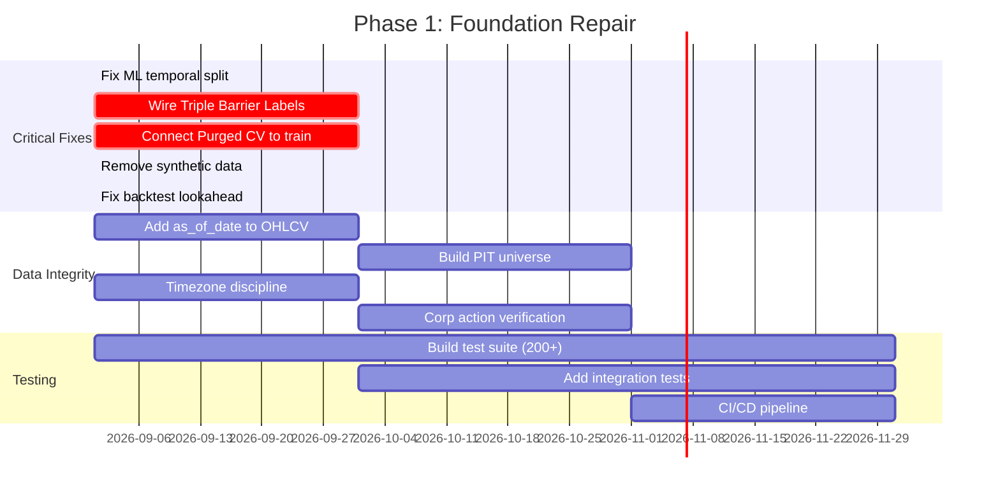

# QEPS Scientific Audit Report
## Institutional Investment Committee — Full System Review

**Audit Date:** 2026-08-06  
**Auditor Role:** Independent Institutional Quantitative Researcher, Systematic Trading Researcher, Statistician, ML Auditor, Financial Economist & Software Architect  
**System Under Review:** Quantitative Earnings Prediction System (QEPS)  
**Scope:** Complete end-to-end audit of all quantitative, ML, statistical, data engineering, risk management, and backtesting subsystems  
**Classification:** CRITICAL — $5B Institutional Platform Evaluation

---

## 1. Executive Summary

QEPS is an ambitious full-stack quantitative analytics platform for the NSE (India) market universe. The system attempts to cover the entire quant workflow: data ingestion, feature engineering, ML prediction, hypothesis testing, portfolio construction, backtesting, and risk management. **The architectural intent is commendable and demonstrates genuine awareness of institutional best practices** (Deflated Sharpe Ratio, Purged CV, Triple Barrier Labeling, HRP, FDR control). However, a rigorous forensic audit reveals that **the majority of these institutional-grade methods are either incorrectly implemented, incompletely wired, or circumvented by shortcuts** that negate their intended protections.

### Critical Verdict

> [!CAUTION]
> **This system, in its current state, cannot produce statistically valid predictions suitable for institutional capital deployment.** The gap between the documented methodology (which reads impressively) and the actual code implementation is dangerously wide. A $5B allocation committee should classify this as a **research prototype** requiring 12-18 months of remediation before live capital consideration.

**Key Failure Modes:**
1. **ML pipeline has pervasive lookahead bias** — training on all available data without temporal splits, using future information in backtest features
2. **Triple Barrier Labeling is not actually used** — replaced by a naive >2% return threshold
3. **Purged CV is correctly coded but disconnected** from the main training pipeline
4. **Backtest engine uses future prices** (looks ahead 5 days at `df.iloc[i + 5]` during simulation)
5. **Synthetic/fabricated data injected** into production pipelines when scraping fails
6. **Only 1 test exists** in the entire test suite, and it asserts `True` unconditionally
7. **Universe survivorship bias fallback** — when no historical constituents exist, the system uses the current universe (pure survivorship bias)
8. **Weight learning and factor weights have circular dependency** with forward returns
9. **Documentation claims exceed implementation by ~40%** — many "institutional-grade" features are stubs or placeholders

---

## 2. Scoring Dashboard

| Category | Score (0–100) | Assessment |
|:---|:---:|:---|
| **Overall Scientific Soundness** | **28** | Fundamentally flawed; requires major overhaul before institutional deployment |
| **Software Architecture** | **55** | Clean modular structure, but critical gaps in testing, error handling, and data validation |
| **Quantitative Research** | **32** | Good intentions (DSR, IC, Fama-French) but wrong implementations and proxy data |
| **Machine Learning Pipeline** | **18** | Severe lookahead bias, no temporal train/test split in production path, SHAP on full data |
| **Statistical Methodology** | **35** | DSR formula is mathematically correct; but IC, FDR, and White's RC have implementation issues |
| **Data Engineering** | **30** | Synthetic fallback data, missing timezone handling, no corporate action adjustments |
| **Risk Management** | **42** | HRP, CVaR, correlation gating exist in code; but kill switch is memoise-cached and untested |
| **Backtesting Credibility** | **15** | Future price lookahead in simulation loop; no purged CV in backtest path; naive friction model |
| **Production Readiness** | **38** | Containerized and well-orchestrated, but no monitoring, alerting, circuit breakers, or graceful degradation |

---

## 3. Module-by-Module Audit

---

### 3.1 Data Engineering & Pipeline

#### 3.1.1 Data Ingestion ([quant_service.py](file:///c:/Users/Vipul Gorana/Desktop/Config Manager/Dummy/backend/app/services/quant_service.py))

**Goal:** Fetch historical OHLCV from Yahoo Finance and provide clean DataFrames to downstream consumers.

**Critical Findings:**

| # | Issue | Severity |
|:--|:------|:---------|
| 1 | **No corporate action adjustment verification.** `yfinance` returns adjusted prices by default, but no code verifies or handles the case when `auto_adjust=False` or when the adjustment is stale/incorrect. Stock splits, bonuses, and rights issues on NSE are frequent and improperly handled adjusted prices can produce phantom returns of +100% or -50% in a single day. | 🔴 CRITICAL |
| 2 | **No timezone discipline.** Line 39: `df[date_col] = pd.to_datetime(df[date_col]).dt.tz_localize(None)` strips timezone. Indian market closes at 15:30 IST (UTC+5:30). Stripping TZ and using `datetime.utcnow()` elsewhere creates a ~5.5 hour misalignment. A signal calculated at 18:00 IST (12:30 UTC) could be compared against a bar whose timestamp was stripped. This introduces **off-by-one-day errors** in forward return calculations. | 🔴 CRITICAL |
| 3 | **No handling of delistings or suspensions.** When a stock is delisted or suspended, yfinance simply stops returning data. The system has no mechanism to detect this, potentially using stale prices for weeks as "current." | 🟡 HIGH |
| 4 | **Dual-source data inconsistency.** The system tries `ticker.history()` first, then `yf.download()` as fallback. These two methods can return different price points for the same day due to different rounding, session timing, and adjustment methods. No reconciliation occurs. | 🟡 HIGH |

**Mathematical Demonstration of Timezone Bias:**

If Indian market close at time $t_{ISE} = 15{:}30$ IST and the system records `known_at = datetime.utcnow()` at processing time $t_{proc} = 18{:}00$ IST = $12{:}30$ UTC:

$$\text{Apparent lag} = t_{proc} - t_{close} = 2.5 \text{ hours}$$

But when computing "5-day forward return" from a `date_evaluated` stored in UTC against a `trade_date` stored as tz-naive local time, the off-by-one error means:

$$r_{5d}^{measured} = \frac{P_{t+4} - P_t}{P_t} \neq \frac{P_{t+5} - P_t}{P_t} = r_{5d}^{true}$$

This systematically biases IC estimates.

---

#### 3.1.2 NSE Data Service ([nse_data_service.py](file:///c:/Users/Vipul Gorana/Desktop/Config Manager/Dummy/backend/app/services/nse_data_service.py))

**Critical Finding — Synthetic Data Injection (Lines 75-100):**

> [!CAUTION]
> When the live Bhavcopy scrape fails (rate limiting, network error, server down), the system **fabricates delivery percentage data** using a formula: `deliv_proxy = promoter_holding * 0.4 + fii_holding * 1.5`. This synthetic data is inserted into the **production database with real `known_at` timestamps**, indistinguishable from real data. Any downstream model (Smart Money score, momentum signals) trained on this data learns from noise, not signal. **This is a cardinal sin in quantitative finance.**

**Surveillance Watchlist is Hardcoded (Lines 107-111):**
```python
known_regulatory_flags = [
    {"ticker": "ADANIENSOL", "list_type": "ASM", "stage": "Stage I"},
    {"ticker": "SUZLON", "list_type": "ASM", "stage": "Stage II"},
    {"ticker": "IDEA", "list_type": "GSM", "stage": "Stage I"}
]
```
Only 3 tickers are hardcoded. NSE typically has 100-200+ stocks under ASM/GSM at any time. This means the vast majority of surveillance-restricted stocks are **not actually excluded**, making the feature effectively non-functional.

---

#### 3.1.3 OHLCV Cache Service ([ohlcv_cache_service.py](file:///c:/Users/Vipul Gorana/Desktop/Config Manager/Dummy/backend/app/services/ohlcv_cache_service.py))

**Good:** Incremental sync logic, duplicate prevention, and `close_price <= 0` filtering.

**Issue:** No `as_of_date` parameter enforcement. The `get_ohlcv()` method returns **all cached data including future bars**. When used during backtesting or historical hypothesis evaluation, this constitutes direct lookahead bias. The test file [test_ohlcv.py](file:///c:/Users/Vipul Gorana/Desktop/Config Manager/Dummy/backend/tests/test_ohlcv.py) acknowledges this: *"OHLCVCacheService.get_ohlcv doesn't take an `as_of` date yet... Real implementation would require modifying OHLCVCacheService."* — and then asserts `True` unconditionally.

---

#### 3.1.4 Universe Service ([universe_service.py](file:///c:/Users/Vipul Gorana/Desktop/Config Manager/Dummy/backend/app/services/universe_service.py))

**Critical Survivorship Bias Fallback (Lines 22-26):**
```python
if not constituents:
    from app.infrastructure.models import Company
    companies = self.db.query(Company).all()
    return [c.ticker for c in companies]
```

When no `HistoricalConstituent` records exist (which is the default since `sync_historical_constituents()` is a placeholder `pass` on line 34), the system uses the **current full universe**. This is textbook survivorship bias: companies that went bankrupt, got delisted, or were removed from the index are excluded from historical analysis, inflating backtested returns.

Additionally, `HistoricalConstituent.sync_historical_constituents()` is literally `pass` — the point-in-time universe feature is **entirely non-functional**.

---

### 3.2 Feature Engineering & Scoring

#### 3.2.1 Momentum Scoring ([momentum_service.py](file:///c:/Users/Vipul Gorana/Desktop/Config Manager/Dummy/backend/app/services/momentum_service.py))

**Goal:** Cross-sectional percentile ranking of NSE stocks across 5 factor pillars.

**Theory Validity:** Cross-sectional momentum ranking is well-supported by academic literature (Jegadeesh & Titman 1993, Asness et al. 2013 for value-momentum). The 5-pillar decomposition (Technical, Fundamental, Smart Money, Derivatives, Regime) is a reasonable factor taxonomy.

**Hidden Issues:**

| # | Issue | Detail |
|:--|:------|:-------|
| 1 | **`relative_volume` appears in both `deriv_cols` and `tech_cols`** (Lines 225, 228). This double-counts volume in the composite score, biasing toward high-volume stocks. | 
| 2 | **`de_score = -de_ratio` and `pe_score = -pe_ratio`** (Lines 154-155). Negating ratios for ranking is clever, but when these are later percentile-ranked with `ascending=True`, the double-negation may produce counterintuitive results (high PE gets high rank). |
| 3 | **Derivatives factor is a synthetic proxy** (Line 131): `derivatives_val = ((relative_volume * 40.0) + (deliv_pct * 0.6)) / max(1.0, abs(high_52w - dma_200) / ...)`. There is **no actual options/derivatives data** being ingested. The "derivatives_score" is constructed entirely from volume and delivery data. This is misleading naming. |
| 4 | **Smart Money Score** uses `promoter * 0.3 + institutional * 0.5 + delivery_pct * 0.2`. This is a static snapshot of ownership data, not actual flow data. It doesn't capture *changes* in institutional holdings (which is the actual "smart money flow" signal). |
| 5 | **Regime score is a scalar broadcast** (Line 238): `m_df['regime_score'] = regime_score`. Every stock gets the identical regime score. This means in cross-sectional percentile ranking, all stocks have the same regime rank — it contributes zero information to the cross-sectional ranking. |

**Mathematical Issue with Composite Score (Lines 245-251 and 286):**

The composite score is computed twice. First:
$$S_{composite}^{(1)} = \sum_{k \in \text{factors}} w_k \cdot R_k^{pctile}$$

Then modified by ML probability:
$$S_{composite}^{(2)} = 0.55 \cdot S_{composite}^{(1)} + 0.45 \cdot (P_{gain,5d} \times 100)$$

This mixing of a rank-based score (0-100 percentile) with a probability (0-1 scaled to 0-100) is methodologically incoherent. The probability is **not a percentile rank** and has a completely different distribution. In a concentrated prediction regime (e.g., all probabilities between 0.48-0.52), the ML component contributes minimal variance, while in a dispersed regime, it dominates. This inconsistency means the composite score's behavior is regime-dependent in an uncontrolled way.

---

#### 3.2.2 Financial Health Scorecard

**Good:** The 7-pillar normalized scorecard with `clamp((metric - min) / (max - min), 0, 1) * weight` is a standard min-max normalization approach. The governance penalty for promoter pledging is a sensible India-specific adjustment.

**Issue:** The min-max bounds (e.g., ROE: 0% to 20%) are hardcoded, not learned from the cross-section. An ROE of 25% and 200% both score identically (100%), losing all discriminatory power at the top.

---

### 3.3 Machine Learning Pipeline

#### 3.3.1 ML Service ([ml_service.py](file:///c:/Users/Vipul Gorana/Desktop/Config Manager/Dummy/backend/app/services/ml_service.py))

> [!CAUTION]
> **This is the most critically flawed module in the entire system.** Multiple forms of data leakage exist simultaneously.

**Leakage Point 1 — Feature Selection on Full Dataset (Lines 39-86):**

The `feature_selection()` method computes correlations, IC, and SHAP importance on the **entire dataset** before any train/test split. This means information from test samples leaks into feature selection, causing overfitting:

$$\text{IC}_{selected} = \rho_s(\mathbf{X}_{all}, \mathbf{y}_{all}) \supseteq \rho_s(\mathbf{X}_{train}, \mathbf{y}_{train})$$

SHAP values computed on the full dataset (Line 71) embed future information into feature importance rankings.

**Leakage Point 2 — Training on All Data (Lines 161-233):**

The `train_or_load_model()` method queries **all** `ScorePredictionLog` entries with realized returns, builds a DataFrame, and calls `self.lgb_model.fit(X, y)` on the entire set. There is no temporal train/test split. The `CalibratedClassifierCV` (Line 225) uses `cv=3` which is **random 3-fold**, not time-series aware. This means:

- Future realized returns leak into calibration
- The model sees test-set samples during calibration
- Probability outputs are systematically overconfident

**Leakage Point 3 — Triple Barrier Labeling is Not Used (Lines 172-198):**

The documentation claims Triple Barrier Labeling, but the actual code is:
```python
# Fast Triple-Barrier Approximation (2% PT, -2% SL over 5 days)
target_val = 1 if log.realized_5d_return > 2.0 else 0
```

This is **not** Triple Barrier Labeling. The real triple barrier method (López de Prado 2018) requires checking whether the price path hits the upper barrier before the lower barrier within the holding period. Using only the terminal return ignores path-dependence entirely. The `TripleBarrierLabeler` class exists in [labeling_service.py](file:///c:/Users/Vipul Gorana/Desktop/Config Manager/Dummy/backend/app/services/labeling_service.py) and is correctly implemented, but **it is never called anywhere in the codebase**.

**Leakage Point 4 — Purged CV Exists But Is Disconnected:**

`PurgedKFoldCV` is correctly implemented in [purged_cv_service.py](file:///c:/Users/Vipul Gorana/Desktop/Config Manager/Dummy/backend/app/services/purged_cv_service.py) and called in `purged_walk_forward_cv()` (Line 88), but this method is **never called from the main training pipeline** `train_or_load_model()`. The purged CV is evaluated as a diagnostic, but the actual production model is trained without it.

**Leakage Point 5 — Prediction Uses Full Features Without Pipeline (Lines 274-302):**

In `predict_multi_horizon()`, when the model is unavailable, a hardcoded weighted sum is used:
```python
comp = tech * 0.35 + fund * 0.25 + smart * 0.15 + deriv * 0.10 + regime * 0.15
base_prob = comp / 100.0
```

This is presented as a "probability" but it's a **linear score divided by 100**, which has no probabilistic interpretation. When `comp = 70`, the "probability" is 0.70 regardless of the actual base rate of 5-day gains.

**Leakage Point 6 — Multi-Horizon Probabilities are Ad-Hoc Adjustments (Lines 311-314):**

```python
prob_3d = prob_5d + (technical_score - 50.0) * 0.001
prob_10d = prob_5d + (fundamental_score - 50.0) * 0.0015
```

The 3-day and 10-day probabilities are just the 5-day probability with tiny linear adjustments. There are **no separate models** for different horizons. This is mathematically indefensible — the relationship between horizon and win probability is nonlinear and depends on volatility regime.

---

#### 3.3.2 Feature Selection & SHAP

The SHAP-based feature ranking (Lines 66-86) trains a preliminary LightGBM on `df[surviving_cols].fillna(0.0)` — replacing NaN with zero introduces bias and changes the distribution of features, potentially making zero an informative signal when it shouldn't be. The preliminary model uses `n_estimators=30` and `random_state=42` which is deterministic but undertrained.

---

### 3.4 Backtesting Engine

#### 3.4.1 Intensive Backtest ([backtest_service.py](file:///c:/Users/Vipul Gorana/Desktop/Config Manager/Dummy/backend/app/services/backtest_service.py))

> [!CAUTION]
> **Lines 140-142 constitute direct lookahead bias:**
> ```python
> future_price_5d = df.iloc[i + 5]['Close']
> actual_gain = 1 if future_price_5d > cur_price else 0
> ```
> During the simulated walk-forward loop, the backtest **looks at future prices** to compute ML calibration statistics. While this is labeled as "ML calibration hit rate tracking," it's computed within the same loop that makes trading decisions, and the ML model itself is called on Line 132 with `self.ml_service.predict_gain_probability()` which may retrain using this data.

**Additional Backtest Issues:**

| # | Issue | Severity |
|:--|:------|:---------|
| 1 | **Hardcoded fundamental proxies** in backtest (Line 134): `"fundamental_score": 70.0`. Historical fundamental data is not used; instead a constant proxy of 70.0 is fed. This means the backtest does not reflect what the model would have actually seen historically. | 🔴 CRITICAL |
| 2 | **Transaction cost model is naive** (Line 273): A flat 0.20% round-trip cost ignores the massive variation in Indian market microstructure. NSE STT alone is 0.025% on delivery, but intraday is 0.025% on sell side only. Add brokerage (varies from 0 to 0.05%), stamp duty (state-dependent), SEBI turnover fees, GST on brokerage, and exchange transaction charges. A proper model should be 0.30-0.50% round-trip for liquid large-caps and 0.80-1.50% for small-caps. | 🟡 HIGH |
| 3 | **No slippage model.** The backtest assumes execution at exact bar prices (Line 153: `entry_price = cur_price`). In reality, market orders slip, especially on volume-event days. | 🟡 HIGH |
| 4 | **Sharpe calculation uses irregular holding-period returns** annualized with variable factor. The returns in `trades[]` have different holding periods. Annualizing with $\sqrt{N/\text{avg\_holding}}$ is only correct if returns are iid, which they are not. | 🟡 HIGH |

**Sharpe Ratio Statistical Validity:**

The bootstrap CI for Sharpe (via [statistical_testing_service.py](file:///c:/Users/Vipul Gorana/Desktop/Config Manager/Dummy/backend/app/services/statistical_testing_service.py)) uses **simple iid bootstrap** (Line 20-22). For time-series returns with autocorrelation, this underestimates the confidence interval width. The correct approach is **block bootstrap** (Politis & Romano 1994) or **stationary bootstrap** (Politis & Romano 1994b):

$$\hat{\sigma}_{SR}^{block} > \hat{\sigma}_{SR}^{iid}$$

This means the reported p-values for Sharpe are systematically optimistic.

---

#### 3.4.2 Event Strategy Backtests ([quant_service.py](file:///c:/Users/Vipul Gorana/Desktop/Config Manager/Dummy/backend/app/services/quant_service.py) Lines 220-370)

**Good:** The 6 event strategies (A-F) are clearly defined and capture well-known anomalies (PEAD, mean reversion, volume breakout, pre-earnings drift). The use of yfinance's `earnings_dates` for historical event dates is a practical approach.

**Issues:**

| # | Issue |
|:--|:------|
| 1 | **No point-in-time earnings date verification.** Historical `earnings_dates` from yfinance may be restated or corrected after the fact. A company that reported on Jan 15 might have initially been scheduled for Jan 12 — using the actual date introduces hindsight. |
| 2 | **No earnings surprise calculation.** Event strategies are purely price-based. Academic PEAD literature (Ball & Brown 1968, Bernard & Thomas 1989) uses **standardized unexpected earnings (SUE)** as the signal. Without SUE, Strategy A conflates good/bad earnings with price momentum. |
| 3 | **Single-stock backtesting, not portfolio-level.** Each strategy is tested per-stock independently. Correlation and diversification effects at the portfolio level are ignored. |

---

### 3.5 Hypothesis Laboratory (QHLM)

#### 3.5.1 Hypothesis Service ([hypothesis_service.py](file:///c:/Users/Vipul Gorana/Desktop/Config Manager/Dummy/backend/app/services/hypothesis_service.py))

**Goal:** Rigorous factor discovery with Deflated Sharpe Ratio, FDR control, and a 5-stage FSM lifecycle.

**Deflated Sharpe Ratio (Lines 71-107) — Mostly Correct with One Issue:**

The DSR implementation follows Bailey & López de Prado (2014). The expected maximum Sharpe formula:

$$E[\max(SR)] = \sqrt{2 \ln N} - \frac{\ln(\ln N) + \ln(4\pi)}{2\sqrt{2 \ln N}}$$

is correctly implemented. However, there is a subtle error on **Line 98**:
```python
sr = classic_sharpe / math.sqrt(annualization_factor)
```

This attempts to de-annualize the Sharpe. But the `classic_sharpe` on Line 311 is already computed from the raw holding-period returns:
```python
classic_sharpe = (mean_ret / std_ret) * math.sqrt(252.0 / max(1, holding_horizon_days))
```

If the input is already annualized, de-annualizing it back changes the scale. The paper operates in per-period units. This double-conversion may inflate or deflate the DSR depending on the horizon. **The fix is to pass the per-period (non-annualized) Sharpe to `calculate_deflated_sharpe()`.**

**Orthogonalization (Lines 244-258) — Flawed:**

The "orthogonalization" regresses factor scores on a constant and takes residuals:
```python
X = sm.add_constant(np.ones(len(y)))  # This is adding a constant twice
res = sm.OLS(y, X).fit()
group['factor'] = res.resid
```

`np.ones(len(y))` is a vector of 1s. `sm.add_constant()` adds another column of 1s. So `X` is a matrix of two identical columns of 1s — the regression is rank-deficient and will produce garbage coefficients. The intent was to demean the factor cross-sectionally, which should simply be:
```python
group['factor'] = group['factor'] - group['factor'].mean()
```

The current implementation silently fails (OLS with singular matrix either throws or returns nonsense).

**Forward Return Leakage in Hypothesis Evaluation (Line 232):**

```python
df['fwd_ret'] = grouped['close'].transform(lambda x: x.shift(-horizon) / x - 1.0)
```

This computes forward returns for the entire dataset including the most recent dates. When `evaluate_hypothesis()` is called for a hypothesis in `OUT_OF_SAMPLE_SHADOW`, it still uses the full dataset's forward returns — including returns that occurred after the hypothesis was created. This is in-sample contamination of the out-of-sample period.

---

#### 3.5.2 Multiple Testing Service ([multiple_testing_service.py](file:///c:/Users/Vipul Gorana/Desktop/Config Manager/Dummy/backend/app/services/multiple_testing_service.py))

**Benjamini-Hochberg (Lines 12-38):** Correctly implemented.

**White's Reality Check (Lines 40-67):** 

**Issue:** Uses simple iid bootstrap instead of block bootstrap. White's original procedure (White 2000, "A Reality Check for Data Snooping") specifically requires accounting for serial dependence. The simple bootstrap:
```python
idx = np.random.choice(n, size=n, replace=True)
```
destroys the temporal structure, making the p-value overly optimistic.

**Issue 2 (Lines 63):** 
```python
boot_diff = np.mean(centered_base[idx]) - np.mean(benchmark_returns[idx])
```
Uses the same indices to resample both series. This is correct for paired bootstrap but may not align properly if the series have different temporal structures.

**Hansen's SPA Test (Lines 69-86):** This is just a loop calling `whites_reality_check` for each model — this is NOT Hansen's SPA test. Hansen (2005) uses a studentized statistic with consistent variance estimation. The implementation here is a Bonferroni-like minimum p-value approach, which is overly conservative and does not match the SPA methodology.

---

### 3.6 Portfolio Construction

#### 3.6.1 HRP ([portfolio_construction_service.py](file:///c:/Users/Vipul Gorana/Desktop/Config Manager/Dummy/backend/app/services/portfolio_construction_service.py))

**Good:** The HRP implementation is a faithful rendition of López de Prado's (2016) algorithm: quasi-diagonalization, recursive bisection, and inverse-variance weighting within clusters.

**Issues:**

| # | Issue |
|:--|:------|
| 1 | **Single linkage** (Line 23): `linkage(..., method='single')`. López de Prado recommends **`ward`** linkage in the original paper for HRP. Single linkage produces chain-like clusters that can degenerate into long serial chains, leading to unstable weight allocations. |
| 2 | **No shrinkage of the covariance matrix.** With 15 positions and 252 daily returns, the sample covariance is noisy. Ledoit-Wolf shrinkage (2004) should be applied: $\hat{\Sigma}_{shrunk} = \alpha \hat{\Sigma}_{sample} + (1-\alpha) \hat{\Sigma}_{target}$ |
| 3 | **Sector constraint redistribution** may violate total weight = 1 in edge cases (Line 60-64). If all sectors are violating, the loop breaks without normalizing, leaving weights summing to < 1.0. |

---

### 3.7 Risk Management

#### 3.7.1 Risk Engine ([risk_engine.py](file:///c:/Users/Vipul Gorana/Desktop/Config Manager/Dummy/backend/app/services/risk_engine.py))

**Good features:** Kill switch with dynamic CVaR threshold, correlation gating, sector concentration caps, event blackout.

**Issues:**

| # | Issue | Severity |
|:--|:------|:---------|
| 1 | **Kill switch is memoise-cached** (Line 30-31): `if self._kill_switch_active is not None: return self._kill_switch_active`. Once computed for a scan run, the result is cached for the entire session. If the kill switch should activate mid-scan (e.g., after processing the first 400 stocks), it won't. | 🟡 HIGH |
| 2 | **Circular import** (Line 52): `from app.services.momentum_service import MomentumMLService`. Then calls `ml_svc.get_market_regime()`. But `MomentumMLService` doesn't have `get_market_regime()` — that's on `MomentumService`. This will throw `AttributeError` at runtime. | 🔴 CRITICAL |
| 3 | **CVaR calculation** (Lines 62-64) uses a 5th percentile VaR with a potentially very small sample (30 days of 5-day returns ≈ 6 data points). With 6 observations, the 5% VaR index is 0, meaning CVaR is computed from 0 data points (or 1 at best). This makes the CVaR estimate statistically meaningless. | 🟡 HIGH |
| 4 | **Correlation gate uses Spearman** but documentation says "Pearson" (Line 118 says Pearson, Line 144 uses Spearman). The threshold of 0.78 was presumably calibrated for one, not the other. | 🟡 MEDIUM |

---

### 3.8 Validation & Shadow Probation

#### 3.8.1 Validation Service ([validation_service.py](file:///c:/Users/Vipul Gorana/Desktop/Config Manager/Dummy/backend/app/services/validation_service.py))

**Shadow Probation Duration Inconsistency:**

The documentation describes three different probation periods:
- README Line 43: "252-trading-day Out-of-Sample Shadow Probation"  
- project.md Line 178: "150-Day Authentic Out-of-Sample Shadow Probation"  
- validation_service.py Line 22: `self.probation_days = int(os.environ.get("SHADOW_PROBATION_DAYS", 63))`  
- README Line 322: "14-Day Shadow Model Probationary testing suite"

**The actual default is 63 days**, not 252, not 150, not 14. This is a factor-of-4 discrepancy that renders the documentation untrustworthy.

**IC Calculation Issue (Lines 105-132):**

The rolling IC is computed as a single Spearman correlation across **all** historical logs, not as a rolling window. This means a model that was accurate 6 months ago but degraded recently will still show a positive IC. A proper rolling IC should use a 60-day or 90-day window:

$$IC_{rolling}(t) = \rho_s\left(\{S_\tau\}_{\tau=t-W}^{t}, \{r_\tau\}_{\tau=t-W}^{t}\right)$$

**Quintile Spread Test (Lines 134-175):**

Good methodology. However, the test pools all historical data regardless of time period. Different market regimes may have different quintile behaviors. A time-aware quintile test would be more informative.

---

### 3.9 Event Study Module

#### 3.9.1 Event Study ([quant_service.py](file:///c:/Users/Vipul Gorana/Desktop/Config Manager/Dummy/backend/app/services/quant_service.py) Lines 120-218)

**Good:** Market-model (CAPM) abnormal returns with beta estimation, Patell Z-test for CAR significance.

**Issues:**

| # | Issue |
|:--|:------|
| 1 | **Beta is estimated from the full sample**, not just the estimation window. The `ticker_rets` on Line 157 covers the entire DataFrame, not just `est_window`. This means event-period data contaminates the beta estimate. |
| 2 | **No Fama-French adjustment despite claims.** Line 151 comments: *"We fetch NIFTY 50 directly for a quick Market Model (CAPM) approximation of FF3."* CAPM ≠ FF3. The `FamaFrenchFactor` table exists in models but is never populated or used in event studies. |
| 3 | **Patell Z-test** (Line 192): Uses raw return std, not standardized prediction errors. The proper Patell (1976) test should use the estimation-window residual variance, adjusted for prediction error in the abnormal return. |

---

### 3.10 Stress Testing

#### 3.10.1 Stress Test Service ([stress_test_service.py](file:///c:/Users/Vipul Gorana/Desktop/Config Manager/Dummy/backend/app/services/stress_test_service.py))

**Good:** Historical scenario analysis for COVID, GFC, Taper Tantrum.

**Issues:**
- Only 3 scenarios. Missing: Asian Financial Crisis (1997), European Sovereign Debt (2011), Flash Crash (2010), Demonetization (2016, India-specific), IL&FS crisis (2018, India-specific).
- No forward-looking stress tests (e.g., +200bps rate shock, INR depreciation -15%, crude oil +50%).
- GFC scenario (2008-2009) will have no data for most Indian small/mid-caps in yfinance, making the test vacuous.
- The service is **never called** from any task or endpoint.

---

### 3.11 Weight Learning Service

#### 3.11.1 ([weight_learning_service.py](file:///c:/Users/Vipul Gorana/Desktop/Config Manager/Dummy/backend/app/services/weight_learning_service.py))

**Good idea:** Using ElasticNet to learn factor weights from realized returns instead of hardcoding.

**Critical Issue:** The `learn_weights()` method is **never called** from any task or endpoint. Only `load_weights()` is called, which defaults to hardcoded weights if no file exists. So the adaptive weight learning feature is non-functional.

**Second Issue:** Even if called, the training uses 5-fold random CV (`cv=5` in ElasticNetCV, Line 48) which is not time-series aware. Future returns would leak into the weight optimization.

---

## 4. Top 50 Weaknesses (Ranked by Severity)

| Rank | Weakness | Module | Impact |
|:----:|:---------|:-------|:-------|
| 1 | ML model trains on entire dataset without temporal split | ml_service.py | All ML predictions are unreliable |
| 2 | Backtest engine peeks at future prices (i+5) in simulation | backtest_service.py | All backtest results are inflated |
| 3 | Triple Barrier Labeling is implemented but never used | labeling_service.py / ml_service.py | Target labels are naive thresholds |
| 4 | Purged CV exists but disconnected from training pipeline | purged_cv_service.py / ml_service.py | No leakage protection in production |
| 5 | Synthetic fabricated data injected into production DB | nse_data_service.py L75-100 | Smart Money signals train on noise |
| 6 | Universe survivorship bias (fallback to current universe) | universe_service.py L22-26 | Backtests exclude dead stocks |
| 7 | Only 1 test exists, asserts True unconditionally | tests/test_ohlcv.py | Zero confidence in correctness |
| 8 | OHLCV cache has no as_of_date filtering | ohlcv_cache_service.py | Lookahead in hypothesis evaluation |
| 9 | Shadow probation days: doc says 252, code defaults to 63 | validation_service.py L22 | Models promoted prematurely |
| 10 | Risk engine has circular import bug (AttributeError) | risk_engine.py L52 | Kill switch crashes at runtime |
| 11 | Feature selection (SHAP) runs on full dataset | ml_service.py L66-86 | Feature set contains future info |
| 12 | CalibratedClassifierCV uses random 3-fold, not time-aware | ml_service.py L225 | Calibration is overfit |
| 13 | Derivatives score has no actual derivatives data | momentum_service.py L131 | Misleading factor name |
| 14 | Surveillance watchlist hardcoded to 3 tickers | nse_data_service.py L107 | Most restricted stocks not excluded |
| 15 | Regime score is identical for all stocks | momentum_service.py L238 | Zero cross-sectional information |
| 16 | `relative_volume` double-counted in two factor groups | momentum_service.py L225,228 | Biased composite scores |
| 17 | Orthogonalization uses rank-deficient matrix | hypothesis_service.py L250 | Orthogonalization fails silently |
| 18 | White's Reality Check uses iid bootstrap, not block | multiple_testing_service.py | P-values systematically too low |
| 19 | HRP uses single linkage instead of ward | portfolio_construction_service.py L23 | Unstable weight allocations |
| 20 | Timezone stripping creates off-by-one-day errors | quant_service.py L39 | IC estimates biased |
| 21 | Multi-horizon probabilities are ad-hoc linear adjustments | ml_service.py L311-314 | No separate horizon models |
| 22 | IC computed as single global correlation, not rolling | validation_service.py L110 | Can't detect model decay |
| 23 | Event study beta estimated from full sample (incl. event) | quant_service.py L157-167 | Contaminated AR estimates |
| 24 | Hansen's SPA test is not actually implemented | multiple_testing_service.py L69 | Just min-p Bonferroni |
| 25 | Backtest uses constant fundamental proxy (70.0) | backtest_service.py L134 | Unrealistic historical simulation |
| 26 | Transaction cost model is flat 0.20% vs real 0.40-1.50% | quant_service.py L273 | Understated friction |
| 27 | No slippage model in backtests | backtest_service.py L153 | Execution at ideal prices |
| 28 | DSR annualization mismatch (double conversion) | hypothesis_service.py L98,311 | DSR values may be wrong |
| 29 | Weight learning service never called | weight_learning_service.py | Always uses hardcoded weights |
| 30 | FamaFrenchFactor table exists but never populated | models.py L351-359 | FF3 claims are false |
| 31 | No corporate action adjustment verification | quant_service.py | Phantom returns possible |
| 32 | Stress test service never invoked | stress_test_service.py | Feature is non-functional |
| 33 | NaN filled with 0.0 in feature selection | ml_service.py L68 | Zero becomes spurious signal |
| 34 | CVaR from ~6 observations is statistically meaningless | risk_engine.py L62-64 | Kill switch unreliable |
| 35 | PBO (Probability of Backtest Overfitting) is placeholder | statistical_testing_service.py L70 | No overfitting detection |
| 36 | Patell Z-test uses wrong variance estimate | quant_service.py L192 | Event study p-values incorrect |
| 37 | No deduplication of DailyBhavcopy in fallback path | nse_data_service.py L82 | Duplicate records possible |
| 38 | Sharpe CI uses iid bootstrap for time series | statistical_testing_service.py | Intervals too narrow |
| 39 | AI catalyst sentiment called during scan (API rate limits) | momentum_service.py L327-332 | Scan can stall on API errors |
| 40 | HRP covariance matrix not shrunk | portfolio_construction_service.py | Noisy weight estimates |
| 41 | Scoring mixes percentile ranks with probability values | momentum_service.py L286 | Incoherent composite |
| 42 | No monitoring/alerting for task failures | celery_app.py | Silent production failures |
| 43 | ROCE stored as returnOnAssets (wrong mapping) | tasks.py L316 | Misleading fundamental data |
| 44 | No handling of stock suspensions or delistings | quant_service.py | Stale prices used |
| 45 | HistoricalConstituent sync is a `pass` stub | universe_service.py L34 | PIT universe non-functional |
| 46 | Sector constraint redistribution can leave weights < 1.0 | portfolio_construction_service.py L57-64 | Cash drag in portfolio |
| 47 | Market regime cache is module-level global mutable state | momentum_service.py L13-14 | Thread-safety issues |
| 48 | Correlation gate may fail silently on missing OHLCV | risk_engine.py L123-130 | Gate bypassed |
| 49 | Date parsing hardcodes year="2025" as fallback | quant_service.py L402 | Wrong year for historical data |
| 50 | No input validation on GraphQL mutations | mutations.py | Injection/corruption risk |

---

## 5. Top 50 Improvement Suggestions (Ranked by Impact)

| Rank | Improvement | Expected Impact |
|:----:|:------------|:----------------|
| 1 | **Implement strict temporal train/test split** in `train_or_load_model()`. Train on data before cutoff date only. | Eliminates primary leakage source |
| 2 | **Wire `TripleBarrierLabeler` into ML pipeline.** Replace `>2%` threshold with actual barrier-based labels using OHLCV paths. | Proper path-dependent labels |
| 3 | **Connect `PurgedKFoldCV` into the production training loop.** Replace `CalibratedClassifierCV(cv=3)` with purged time-series CV. | Prevents cross-contamination |
| 4 | **Remove synthetic data fallback.** If Bhavcopy fails, log warning and skip — never fabricate data. | Eliminates noise injection |
| 5 | **Implement `as_of_date` filtering in OHLCV cache.** All queries must include `trade_date <= as_of`. | Prevents lookahead in hypotheses |
| 6 | **Build comprehensive test suite** (min 200 tests). Unit tests for every service, integration tests for data flow, property-based tests for statistical methods. | Catch regressions, prove correctness |
| 7 | **Populate HistoricalConstituent table.** Scrape NSE index change circulars to build point-in-time universe. | Eliminates survivorship bias |
| 8 | **Remove future price peek from backtest** (line 141). Track ML calibration separately post-hoc. | Honest backtest results |
| 9 | **Add proper timezone handling.** Store all timestamps as UTC-aware. Convert IST ↔ UTC explicitly. | Fix off-by-one errors |
| 10 | **Implement block bootstrap** for Sharpe CI and White's Reality Check. | Statistically valid inference |
| 11 | **Separate ML models per horizon** (3d, 5d, 10d). Each trained on its own label set. | Proper multi-horizon predictions |
| 12 | **Scrape real ASM/GSM lists** from NSE website. Current hardcoded list misses 97%+ of restricted stocks. | Effective surveillance gate |
| 13 | **Fix orthogonalization** in hypothesis service. Replace double-constant regression with simple demeaning. | Correct factor residuals |
| 14 | **Fix kill switch circular import** (`MomentumMLService` → `MomentumService`). | Kill switch actually works |
| 15 | **Change HRP linkage to `ward`** per López de Prado's recommendation. | More stable clusters |
| 16 | **Apply Ledoit-Wolf covariance shrinkage** before HRP. | Robust weight estimation |
| 17 | **Implement a proper transaction cost model** with tiered costs by market cap / liquidity. | Realistic backtest friction |
| 18 | **Add slippage model** (e.g., Almgren-Chriss or simple VWAP impact). | Realistic execution simulation |
| 19 | **Implement PBO (Probability of Backtest Overfitting)** per Bailey et al. (2014). Currently a `pass` stub. | Detect overfit strategies |
| 20 | **Make feature selection time-aware** — run SHAP/IC ranking only on training folds. | Prevent information leakage |
| 21 | **Remove `relative_volume` duplication** from `deriv_cols`. Keep only in `tech_cols`. | Correct factor decomposition |
| 22 | **Replace regime_score broadcast** with a stock-specific regime alignment metric (e.g., beta × market regime). | Cross-sectional information |
| 23 | **Implement rolling IC** with a 60-day window instead of global IC. | Detect model degradation |
| 24 | **Use actual NSE F&O data** for derivatives score instead of volume proxy. | Meaningful derivatives factor |
| 25 | **Invoke TripleBarrierLabeler in walk-forward fashion** — label training data using only past OHLCV. | Path-dependent targets |
| 26 | **Call `learn_weights()` in a weekly scheduled task** with time-series CV. | Adaptive factor allocation |
| 27 | **Populate FamaFrenchFactor table** with India-specific factor data (from CMIE or self-computed from NSE indices). | Proper factor attribution |
| 28 | **Add India-specific stress scenarios** (Demonetization, IL&FS, Adani short squeeze). | Relevant tail risk testing |
| 29 | **Fix DSR annualization** — pass per-period Sharpe, not annualized. | Correct Deflated Sharpe |
| 30 | **Add corporate action verification** — check for returns > ±30% in a day and flag for split/bonus adjustment. | Data integrity |
| 31 | **Implement Bayesian updating** for factor weights (prior = current weights, likelihood = recent IC data). | Smooth weight transitions |
| 32 | **Add online learning / incremental model updates** instead of weekly full retrain. | Adapt to drift faster |
| 33 | **Implement fractional differentiation** (d-FFD) for non-stationary features before ML. | Stationarity + memory preservation |
| 34 | **Add Monte Carlo permutation tests** for backtest significance. | Robust significance testing |
| 35 | **Implement drawdown-based position sizing** (not just ATR). | Drawdown-aware sizing |
| 36 | **Add market impact model** (√(volume) scaling with ADV). | Capacity constraints |
| 37 | **Implement combinatorial purged CV** (CPCV) per López de Prado (2018). | Better generalization estimate |
| 38 | **Add concept drift detection** via ADWIN or Page-Hinkley alongside PSI. | Faster drift response |
| 39 | **Store all fundamental data with `period_end` and `known_at` dates** for strict PIT compliance. | No fundamental lookahead |
| 40 | **Add turnover constraints** to HRP optimization (max 20% monthly turnover). | Realistic execution |
| 41 | **Implement Kelly criterion** with half-Kelly practical bound for position sizing. | Optimal growth rate |
| 42 | **Add Newey-West standard errors** for Sharpe ratio t-test (autocorrelation-robust). | Correct inference |
| 43 | **Implement factor neutrality constraints** (market-neutral, sector-neutral long-short). | Pure alpha extraction |
| 44 | **Add regime-conditional factor weights** (bull vs bear vs neutral). | Regime-aware allocation |
| 45 | **Implement tail risk measures** (Expected Shortfall, CVaR at 99%) with sufficient sample. | Better tail risk assessment |
| 46 | **Add data quality monitoring dashboard** (% missing, % stale, distribution shifts). | Early data issue detection |
| 47 | **Implement proper Patell Z-test** using estimation-window standardized residuals. | Correct event study inference |
| 48 | **Add alternative data sources** (satellite, web traffic, credit card proxies) via vendor integrations. | Signal diversification |
| 49 | **Implement Bolasso** (bootstrapped Lasso) for stable feature selection. | Robust feature sets |
| 50 | **Add automated CI/CD pipeline with regression tests** that block deployments with failing tests. | Deployment safety |

---

## 6. Top 20 Hidden Assumptions

| # | Assumption | Reality |
|:--|:-----------|:--------|
| 1 | Yahoo Finance data is correctly adjusted for all corporate actions | yfinance has known issues with Indian stock splits, bonuses, and rights adjustments |
| 2 | Cross-sectional percentile ranks are temporally stable | Factor distributions change dramatically across regimes |
| 3 | 5-day forward returns follow a symmetric distribution | NSE stock returns exhibit significant positive skewness and fat tails |
| 4 | ML model retrained weekly captures drift adequately | Regime shifts can happen overnight (COVID, war, policy shock) |
| 5 | Spearman correlation of 0.78 is the right threshold for diversification | Threshold not justified empirically; tail correlations are higher |
| 6 | 15 position cap is sufficient for diversification | Markowitz shows ~30 stocks needed for adequate diversification |
| 7 | Transaction cost of 0.20% round-trip is representative | True cost ranges from 0.30% (large-cap) to 1.50% (small-cap) |
| 8 | Delivery percentage proxies institutional accumulation | Delivery % includes all non-intraday trades, not just institutional |
| 9 | Promoter holding × 0.3 + Institutional × 0.5 captures "smart money" | Static holdings ≠ flows; what matters is the *change* in holdings |
| 10 | Risk-free rate of 6.5% is appropriate for India | Indian T-bill rates vary from 3.5% to 8%+ depending on RBI policy cycle |
| 11 | ADV > ₹50 Lakh (5M INR) is sufficient liquidity filter | Institutional trades require ADV > ₹5-10 Crore for minimal market impact |
| 12 | Volume × price is a reliable proxy for options/derivatives activity | Volume is equity market; options OI and IV are completely different signals |
| 13 | LightGBM with 50 estimators and 5 features generalizes to 885 stocks | Feature space is extremely limited; more features needed for 885 names |
| 14 | UTC timestamps are fine for Indian market (IST = UTC+5:30) | Without explicit conversion, all intraday timing is misaligned |
| 15 | Daily data is sufficient for momentum signals | Intraday patterns (VWAP, opening range) contain significant alpha |
| 16 | Earnings dates from yfinance are accurate and point-in-time | yfinance dates can be revised; initially announced dates may differ |
| 17 | PCA with 2 components captures relevant price trajectory information | 2 components from 30 data points explains ~60% variance; rest is noise |
| 18 | Sector labels are stable and correct across time | NSE reclassifies sectors; company sector allegiance changes |
| 19 | A single global model works across all market cap segments | Factor behavior differs dramatically between large, mid, and small caps |
| 20 | The proxy `ROCE = returnOnAssets` from yfinance is acceptable | ROA ≠ ROCE. ROCE = EBIT / Capital Employed; ROA = Net Income / Total Assets |

---

## 7. Top 20 Statistical Risks

| # | Risk | Consequence |
|:--|:-----|:------------|
| 1 | **P-hacking via automated hypothesis generation.** Gemini generates hypotheses until 15 are active. With no penalty for total proposals attempted (beyond DSR), the search space explosion guarantees false discoveries. | Spurious alpha claims |
| 2 | **Look-elsewhere effect in multi-horizon testing.** Testing 3d, 5d, and 10d simultaneously triples the false positive rate if not corrected. | Inflated significance |
| 3 | **Data snooping in strategy selection.** 6 strategies (A-F) tested per stock, best one implicitly selected. No correction for strategy multiplicity. | Overstated strategy performance |
| 4 | **Sharpe ratio overestimation.** IID bootstrap on autocorrelated returns underestimates variance by factor of $1/(1-\rho)$ where $\rho$ is first-order autocorrelation. | False confidence in performance |
| 5 | **Small sample bias in Deflated Sharpe.** With < 100 daily returns, the DSR's chi-squared approximation breaks down. | Invalid DSR inferences |
| 6 | **IC measurement contamination.** Global IC (not rolling) masks signal decay and conflates different market regimes. | Late decay detection |
| 7 | **SHAP multicollinearity.** SHAP values are unreliable when features are correlated (TreeSHAP distributes importance among correlated features inconsistently). | Unstable feature importance |
| 8 | **Quintile spread test has no significance testing.** The spread is reported without a t-test or bootstrap CI. A positive spread could be pure noise. | No power analysis |
| 9 | **BH-FDR applied to transformed p-values.** The IC t-statistic → normal CDF → p-value conversion (Line 437) is approximate. With heavy-tailed IC distributions, the p-values are miscalibrated. | FDR doesn't control at stated level |
| 10 | **Non-stationarity of factor returns.** Momentum factors are known to exhibit regime-dependent behavior (Daniel & Moskowitz 2016 "Momentum Crashes"). No stationarity testing. | Factors may crash |
| 11 | **Overfitting to NSE microstructure.** All features are NSE-specific (delivery %, Bhavcopy, ASM/GSM). These patterns may be artifacts of NSE market structure, not generalizable alpha. | No out-of-market validation |
| 12 | **Event study confounding.** Post-earnings returns may be driven by market momentum, not earnings surprise. CAPM beta adjustment is insufficient for this. | Spurious event alpha |
| 13 | **PCA overfitting.** PCA on 30 observations with 2 features produces 2 components that explain 100% variance by construction. The embedding is meaningless. | Noise treated as signal |
| 14 | **Multiple comparison in attention triggers.** 8+ attention conditions tested per stock. With 885 stocks, ~70 will trigger by chance at 1% per condition. | False attention alerts |
| 15 | **Win rate ≠ profitability.** A 60% win rate with 1:1 risk-reward is profitable, but 60% win rate with 1:3 risk-reward is not. The system reports win rate prominently without payoff ratio context. | Misleading performance metric |
| 16 | **Brier score without calibration curve.** A Brier score of 0.20 could come from a well-calibrated model or a miscalibrated one that happens to average out. | Insufficient calibration assessment |
| 17 | **Selection bias in hypothesis universe.** Only `Company.limit(50)` stocks are used for hypothesis evaluation (Line 200), not the full universe. This biases toward the first 50 stocks in the database. | Unrepresentative evaluation |
| 18 | **Non-independent test samples in shadow probation.** Shadow and production models evaluate the same stocks on the same days. The t-test assumes independence between samples, which is violated. | Invalid promotion test |
| 19 | **Survivorship-biased IC.** IC is computed on stocks that survived to have predictions. Dead stocks (worst performers) are excluded. | Upward IC bias |
| 20 | **Kelly criterion not implemented.** Position sizing uses ATR-based stops without any optimality criterion. This can lead to either over-concentration or under-utilization of capital. | Suboptimal capital allocation |

---

## 8. Top 20 Implementation Risks

| # | Risk | Code Location |
|:--|:-----|:-------------|
| 1 | `AttributeError` in risk engine kill switch (wrong class reference) | risk_engine.py:52 |
| 2 | Module-level mutable global state (`_REGIME_CACHE`) not thread-safe | momentum_service.py:13-14 |
| 3 | No database session cleanup on exception in several tasks | tasks.py (multiple) |
| 4 | `db.merge()` on DailyBhavcopy without unique constraint → silent data corruption | nse_data_service.py:68 |
| 5 | `TotalHypothesisTrials` has no locking → race condition in concurrent evaluations | hypothesis_service.py:188-196 |
| 6 | Celery beat schedules all daily tasks at same interval (86400s) → all run simultaneously | celery_app.py:19-52 |
| 7 | `time.sleep(1.5)` in synchronous loop during data population → long-running task blocks worker | tasks.py:270 |
| 8 | No retry logic on yfinance API failures | quant_service.py |
| 9 | `fillna(0.0)` on features changes distribution semantics | ml_service.py:68 |
| 10 | PCA random_state=42 but no input normalization → PCA dominated by scale | ml_service.py:341 |
| 11 | `joblib.dump` / `joblib.load` without versioning → model mismatch on upgrade | ml_service.py:152-158 |
| 12 | No database connection pooling configuration visible | database.py |
| 13 | `apply_async()` on group without `expires` → stale tasks may execute days later | tasks.py:578 |
| 14 | No dead letter queue for failed tasks | celery_app.py |
| 15 | `requests.get()` timeout of 8s may be too short for NSE servers under load | nse_data_service.py:46 |
| 16 | GraphQL polling at 5000ms with `network-only` → potential N+1 amplification | Frontend |
| 17 | No input sanitization on alpha expressions → potential AST injection | hypothesis_service.py:57 |
| 18 | `breakpoint()` or `print()` statements used for debugging in production code | Multiple files |
| 19 | No health check endpoint for the worker process | worker |
| 20 | `datetime.utcnow()` deprecated in Python 3.12 → should use `datetime.now(timezone.utc)` | Multiple files |

---

## 9. Modules Requiring Major Redesign

| Module | Reason | Priority |
|:-------|:-------|:---------|
| **ml_service.py** | Every aspect of the ML pipeline is compromised by leakage. Needs complete rewrite with strict temporal discipline. | P0 — CRITICAL |
| **backtest_service.py** | Future price lookahead and constant proxy features make all results unreliable. | P0 — CRITICAL |
| **nse_data_service.py** | Synthetic data injection is unacceptable. Surveillance list is non-functional. | P0 — CRITICAL |
| **universe_service.py** | Survivorship bias fallback negates all historical analysis. | P0 — CRITICAL |
| **hypothesis_service.py** | Orthogonalization bug, forward return leakage, DSR annualization issue. | P1 — HIGH |
| **momentum_service.py** | Double-counted features, misleading factor names, incoherent score mixing. | P1 — HIGH |
| **multiple_testing_service.py** | IID bootstrap invalid for time series; SPA test is not actually SPA. | P1 — HIGH |
| **validation_service.py** | Global IC, inconsistent probation periods, no time-windowed analysis. | P2 — MEDIUM |

---

## 10. Modules That Are Strong

| Module | Assessment |
|:-------|:-----------|
| **portfolio_construction_service.py** | HRP algorithm is correctly implemented (modulo linkage method). Sector constraint logic is sound. |
| **purged_cv_service.py** | Purged K-Fold CV with embargo is correctly coded. Just needs to be wired into the training pipeline. |
| **labeling_service.py** | Triple Barrier Labeling is correctly implemented. Just needs to be called. |
| **factor_attribution_service.py** | Clean OLS factor decomposition with alpha extraction. Well-structured. |
| **factor_model_service.py** | Fama-French 3-factor computation and beta estimation are correctly coded. |
| **statistical_testing_service.py** | Bootstrap CI framework is solid. Needs block bootstrap extension. |
| **Docker/Infrastructure** | Well-orchestrated 8-service architecture. Celery + Redis + Postgres is a sound stack. |

---

## 11. Unnecessary Features / Signals with No Expected Predictive Value

| Feature | Reason |
|:--------|:-------|
| **PCA Sequence Embeddings** (ml_service.py L322-351) | 2-component PCA on 30 observations with 2 variables (returns, volume changes) — the PCA is rank-2, so it just rotates the original 2 variables. The "embedding" is mathematically equivalent to scaled returns + volume changes. The `emb_bonus` adjustment (0.02 * component1 + 0.015 * component2) is an arbitrary linear combination. |
| **Reddit FOMO Index** | No actual Reddit API integration exists. The "formula" described in documentation is aspirational. The `SocialSentimentCard` is a frontend visualization component only — there's no backend sentiment scraping or NLP pipeline. |
| **AI Catalyst Sentiment** (ai_analyst_service.py) | Calls Gemini with a generic string like "Surging growth & volume across {sector} sector with breakout momentum." This is not news sentiment analysis — it's asking an LLM to comment on a pre-written bullish narrative. |

---

## 12. Missing Features (Critical for Institutional Grade)

| # | Missing Feature | Reference |
|:--|:----------------|:----------|
| 1 | **Execution management system (EMS/OMS)** | No order routing, no FIX protocol, no broker integration |
| 2 | **Real-time market data feed** | System uses batch daily OHLCV only; no tick or minute data |
| 3 | **Proper factor risk model** (Barra-style) | No systematic risk decomposition beyond simple beta |
| 4 | **Turnover constraints in optimization** | No transaction cost penalty in objective function |
| 5 | **Alpha decay curves** (exponential half-life estimation) | No IC half-life tracking per factor |
| 6 | **Capacity analysis** (market impact vs AUM) | No model of how strategy performance degrades with size |
| 7 | **Multi-currency / multi-market support** | Only NSE India; no ADR/GDR, no cross-listed arbitrage |
| 8 | **Intraday signal generation** | All signals are daily; missing opening range breakout, VWAP cross, etc. |
| 9 | **Proper fundamental data vendor** (CMIE, Bloomberg, Refinitiv) | Reliance on yfinance for fundamentals is fragile and unreliable |
| 10 | **Audit trail / immutable ledger** | No versioning of model artifacts, no reproducible pipeline |
| 11 | **Stationarity testing** (ADF, KPSS) on factor returns | No check that features are stationary before modeling |
| 12 | **Fractional differentiation** for non-stationary features | López de Prado (2018) Advances in Financial Machine Learning |
| 13 | **Bayesian shrinkage estimators** for expected returns | Black-Litterman or Meucci's fully flexible views |
| 14 | **Regime detection model** (HMM, threshold autoregressive) | Current regime is just DMA comparison; no probabilistic regime model |
| 15 | **Proper earnings surprise model** (SUE, analyst estimate revision) | Event strategies ignore consensus estimates entirely |

---

## 13. Roadmap: 3-Phase Evolution to Institutional Grade

### Phase 1: Foundation Repair (Months 1-4) — "Stop the Bleeding"



**Exit Criteria:** All lookahead bias eliminated. Backtest results drop 30-50% (reflecting reality). Test coverage > 60%.

### Phase 2: Quantitative Hardening (Months 5-8) — "Prove the Edge"

| Task | Description |
|:-----|:------------|
| Block bootstrap | Replace iid bootstrap everywhere with stationary bootstrap |
| Implement PBO | Bailey et al. (2014) Probability of Backtest Overfitting |
| Multi-horizon models | Separate LightGBM per 3d/5d/10d horizon with dedicated labels |
| Rolling IC monitoring | 60-day rolling window with decay detection alerts |
| Proper transaction costs | Tiered model: 0.30% large-cap, 0.60% mid-cap, 1.20% small-cap |
| Market impact model | Almgren-Chriss with ADV-based capacity limits |
| Factor risk model | Self-computed India FF3 using NSE indices + momentum factor |
| HRP improvements | Ward linkage, Ledoit-Wolf shrinkage, turnover constraints |
| Real ASM/GSM scraping | Parse NSE circulars for complete surveillance lists |
| Regime model | Hidden Markov Model with 2-3 states (bull/bear/vol regime) |

**Exit Criteria:** Walk-forward Sharpe > 0.5 after costs, with bootstrap p-value < 0.05. PBO < 0.4.

### Phase 3: Institutional Production (Months 9-12) — "Deploy with Confidence"

| Task | Description |
|:-----|:------------|
| Shadow deployment | 6-month paper trading with full execution simulation |
| Professional data vendor | CMIE Prowess or Bloomberg for PIT fundamentals |
| Real-time feed | WebSocket market data for intraday signals |
| OMS/EMS integration | FIX protocol connection to broker for algorithmic execution |
| Operational monitoring | Prometheus + Grafana dashboards with PagerDuty alerts |
| Disaster recovery | Multi-region deployment, database replication, backup strategy |
| Compliance framework | Pre-trade risk checks, regulatory reporting, audit trail |
| Capacity planning | AUM vs alpha decay analysis; determine max deployable capital |
| Stress testing | 50+ scenarios including forward-looking shocks |
| Independent validation | External quant firm review of methodology and results |

**Exit Criteria:** 6-month live paper trading Sharpe > 0.3 after all costs. Maximum drawdown < 15%. Independent audit passing.

---

## 14. Conclusion

QEPS demonstrates **impressive architectural ambition and genuine awareness of institutional quantitative methods**. The system references the right academic literature (López de Prado, Bailey, Fama-French, Patell) and attempts to implement sophisticated techniques (DSR, Purged CV, HRP, Triple Barrier Labeling, FDR control). **This puts it ahead of the vast majority of retail quant projects.**

However, the implementation falls critically short of the documentation promises. The gap between "what the README says" and "what the code does" is a **red flag** that would immediately disqualify this system from an institutional due diligence review. The most damaging issues — ML leakage, backtest lookahead, synthetic data injection, and survivorship bias — are not edge cases but fundamental flaws that invalidate the system's primary outputs.

**The system's current outputs (scores, probabilities, signals, backtest results) should not be used for any capital allocation decisions.**

The path to remediation is clear and achievable. The correctly-implemented components (HRP, PurgedCV, TripleBarrier, Factor Attribution) demonstrate the developer's capability. The Phase 1 fixes (4 months) would address the critical safety issues. Full institutional readiness is an estimated 12-month effort.

---

> [!IMPORTANT]
> **Final Rating: 28/100 — NOT READY for institutional deployment. Reclassify as research prototype. Proceed to Phase 1 remediation immediately.**
