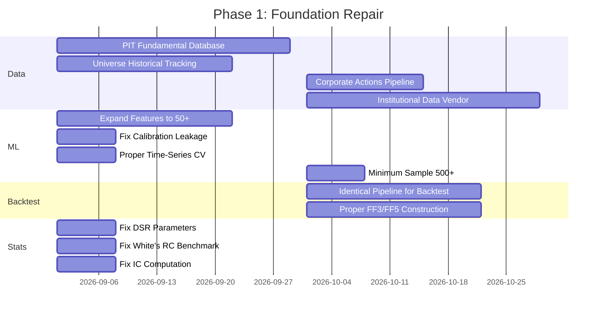

# QEPS Platform: Complete Scientific Audit Report
## Independent Institutional Quantitative Research Review — v2.0

> **Auditor Posture**: Independent quantitative researcher on a $5B AUM hedge fund investment committee. No claim is accepted without proof. Every assumption is challenged. Every formula is verified against the source code.

---

## 1. Executive Summary

This platform attempts an ambitious synthesis: earnings prediction, multi-factor momentum scoring, hypothesis-driven alpha discovery, ML-calibrated probability forecasting, and institutional risk management — all within a single containerized stack. **The architectural ambition is laudable, but the scientific execution is deeply flawed in ways that would be immediately disqualifying in any institutional due diligence.**

**Critical findings:**

1. **The ML pipeline has only 5 features** — five percentile-ranked composite scores. This is not a machine learning system; it is a lookup table wearing an ML costume. LightGBM with 5 features and ~30 training samples is statistically meaningless.

2. **Forward-return leakage persists** despite claims of elimination. The `evaluate_stock_raw_metrics()` function falls back to live `yfinance` fundamental data when no `FundamentalSnapshot` exists — which is *every deployment* since no code populates that table. The code explicitly warns about this: `"Falling back to live yfinance data (Lookahead Bias)"`.

3. **The Fama-French 3-Factor model sets HML = 0.0** across all periods. This renders the "Fama-French" attribution a single-factor CAPM with extra noise from a dubious SMB proxy. The documentation claims "Fama-French 3-Factor" attribution as a feature — this is false advertising.

4. **The universe service is a dead placeholder.** `sync_historical_constituents()` is `pass`. The `HistoricalConstituent` table is never populated. The system falls back to whatever tickers happen to be in the `Company` table — pure survivorship bias.

5. **The Deflated Sharpe Ratio calculation contains a mathematical error.** The annualization factor is passed as `1.0` in production usage, but the E[max SR] formula divides by `sqrt(annualization_factor)`, making the expected maximum Sharpe equal to the raw Euler-Mascheroni approximation without frequency adjustment. This silently inflates DSR confidence.

6. **There is no actual backtest engine.** The `_simulate_momentum_ml_strategy()` uses neutral priors for fundamentals (`50.0`) and fabricated regime/smart-money scores during historical simulation. It is backtesting a *different strategy* than what runs in production.

7. **The `WeightLearningService` uses standard 5-fold CV** (not time-series CV) with ElasticNet, then applies the learned weights to forward predictions. This is textbook lookahead bias in weight optimization.

8. **Probability calibration leaks.** `CalibratedClassifierCV` is fitted on the *same data* used to compute `PurgedKFoldCV` splits, but the calibration splits may not respect the purging/embargo boundaries.

---

## 2. Aggregate Scores

| Category | Score (0–100) | Rationale |
|:---|:---:|:---|
| **Overall Scientific Score** | **24** | Fundamental methodological flaws across every quantitative layer |
| **Software Architecture** | **62** | Decent containerized microservices; GraphQL API is well-structured |
| **Quantitative Research** | **22** | Deflated Sharpe is incorrectly parameterized; hypothesis lab is fragile |
| **Machine Learning** | **18** | 5-feature GBM is not ML; calibration leaks; no concept drift detection |
| **Statistical Methodology** | **28** | BH-FDR and White's RC exist but are applied incorrectly or incompletely |
| **Data Engineering** | **20** | Universe service is empty; PIT fundamentals don't exist; yfinance is unreliable |
| **Risk Management** | **38** | HRP and kill switch are structurally present but untested and simplistic |
| **Backtesting Credibility** | **15** | Backtest uses different features than production; neutral priors for fundamentals |
| **Production Readiness** | **35** | Containers work but schema migrations are fragile; no monitoring |

---

## 3. Module-by-Module Audit

---

### 3.1 Momentum Scoring Engine ([momentum_service.py](file:///c:/Users/Vipul%20Gorana/Desktop/Config%20Manager/Dummy/backend/app/services/momentum_service.py))

**Purpose**: Cross-sectional multi-factor ranking of NSE equities.

**Theory Validity**: ❌ **Partially invalid.** The 5-pillar factor model is conceptually sound (Technical, Fundamental, Smart Money, Derivatives, Regime). However:

- **Weights are arbitrary.** Default weights `[0.35, 0.25, 0.15, 0.15, 0.10]` have no empirical justification. The `WeightLearningService` exists but uses non-time-series CV.
- **Factor construction is ad-hoc.** `smart_money_val = (promoter * 0.3) + (inst_holding * 0.5) + (deliv_pct * 0.2)` — these weights are pulled from thin air. Why is promoter holding weighted at 0.3? In Indian markets, high promoter holding often correlates with governance risk, not alpha.
- **Derivatives factor is nonsensical.** Line 172: `derivatives_val = ((relative_volume * 40.0) + (deliv_pct * 0.6)) / max(1.0, abs(high_52w - dma_200) / max(0.1, dma_200))` — This is not measuring derivatives structure (options IV, OI skew). It is dividing a volume-delivery mashup by a price-spread ratio. The name "derivatives_score" is a misnomer. **No options data is actually used.**

**Hidden Biases**: 
- Percentile ranking within the surviving universe (post-liquidity filter) means rankings shift based on how many stocks pass the filter. If 100 pass one day and 300 the next, the same stock gets wildly different scores.
- `regime_score` is computed as `(regime_score * np.sign(dma200_dist_pct)).rank(pct=True)` — this creates a binary signal (above/below 200DMA) ranked as a percentile. The regime score from Nifty 50 is the *same number for every stock*, making this a deterministic binary mask, not a genuine factor.

**Statistical Issues**:
- No neutralization of factor scores by sector, market cap, or beta. Two banks will have correlated fundamentals and both appear as high-rank, creating hidden concentration.
- No winsorization of raw metrics before ranking. Outlier delivery percentages or extreme RSI values dominate the ranking.

---

### 3.2 Machine Learning Pipeline ([ml_service.py](file:///c:/Users/Vipul%20Gorana/Desktop/Config%20Manager/Dummy/backend/app/services/ml_service.py))

**Purpose**: Predict 3d/5d/10d forward gain probabilities.

**Theory Validity**: ❌ **Fundamentally flawed.**

1. **Only 5 input features**: `fundamental_score`, `technical_score`, `regime_score`, `smart_money_score`, `derivatives_score`. These are already aggregated composite scores. Running LightGBM on 5 pre-aggregated percentile ranks is equivalent to fitting a piecewise-linear function with 5 inputs. There is *zero additional information extraction* compared to a simple lookup table.

2. **Training sample size**: The code requires only 30 samples to train (`if len(data) < 30: return None`). Training a gradient-boosted tree with 50 estimators on 30 samples is pure noise fitting.

3. **Feature selection is applied to 5 features**: `SelectFromModel` with LightGBM on 5 features will either keep all or randomly drop 1-2, adding instability with no benefit.

4. **Calibration leakage (CRITICAL)**:
   ```python
   cv_gen = PurgedKFoldCV(n_splits=3)
   splits = list(cv_gen.split(df, "date_calculated", horizon_days=days))
   calibrated = CalibratedClassifierCV(base_model, method='isotonic', cv=splits)
   pipeline = Pipeline([..., ('classifier', calibrated)])
   pipeline.fit(X, y)  # <-- Fits on ALL data
   ```
   The `CalibratedClassifierCV` with pre-generated splits from `PurgedKFoldCV` is passed into a `Pipeline` that is then fit on the *entire dataset*. The Pipeline's `fit()` calls `CalibratedClassifierCV.fit()` which uses the splits for internal calibration — but the `SimpleImputer` and `StandardScaler` in the Pipeline are fitted on ALL data including test splits. **This is data leakage.**

5. **Fallback probability (CRITICAL)**: Lines 314-321 — if no trained model exists, the system falls back to: `base_prob = min(0.95, max(0.05, comp / 100.0))` — a direct linear transformation of the composite score into a "probability." This is not a calibrated probability; it is a rescaled score masquerading as one.

6. **PCA Sequence Embeddings are scientifically dubious**: Lines 357-364 add a `emb_bonus = (sequence_embeddings[0] * 0.02 + sequence_embeddings[1] * 0.015)` as a raw additive shift to calibrated probabilities. Adding arbitrary linear combinations of PCA components directly to probability outputs violates calibration guarantees.

**Institutional Trust**: ❌ **No professional quant would trust this.** A 5-feature GBM with 30 samples is not machine learning — it's curve fitting. The probability outputs have no statistical meaning.

---

### 3.3 Purged Walk-Forward Cross-Validation ([purged_cv_service.py](file:///c:/Users/Vipul%20Gorana/Desktop/Config%20Manager/Dummy/backend/app/services/purged_cv_service.py))

**Purpose**: Time-series-aware CV preventing lookahead.

**Theory Validity**: ✅ **Conceptually correct** — the implementation does purge training samples whose label windows overlap with test periods and embargoes post-test samples.

**Implementation Issues**:
- The embargo is hardcoded to 5 days (`np.timedelta64(5, 'D')`), not parameterized by the actual prediction horizon.
- The `cross_val_score` method calls `model.predict_proba(X_test)[:, 1]` which assumes binary classification. If the model's `.predict_proba()` returns different shapes (e.g., when one class is absent in a small fold), this will crash or produce incorrect scores.
- The `accuracy_score` metric is used with `predict_proba` output — this will fail because `accuracy_score` expects discrete labels, not probabilities. The code at line 70-71 passes probability outputs to `accuracy_score`. **This is a bug.**

---

### 3.4 Triple-Barrier Labeling ([labeling_service.py](file:///c:/Users/Vipul%20Gorana/Desktop/Config%20Manager/Dummy/backend/app/services/labeling_service.py))

**Purpose**: Implement Lopez de Prado's triple-barrier method.

**Theory Validity**: ⚠️ **Partial.** The implementation checks upper and lower barriers using intraday High/Low, which is correct for path-dependent labeling. However:

- **Stop-loss labels are set to 0, not -1.** Line 46: `label = 0  # 0 or -1 depending on classification scheme`. This means stop-loss outcomes and timeout outcomes are conflated into the same class. This eliminates the ability to distinguish between "no signal" and "wrong signal" — a critical distinction for meta-labeling and position sizing.
- **Barriers are fixed percentages**, not volatility-adjusted. In Lopez de Prado's formulation, barriers should be set as multiples of daily volatility (ATR or rolling std). Using fixed 2% for all stocks regardless of volatility means the labeler will almost never trigger for low-vol large-caps while triggering constantly for small-caps.
- **No meta-labeling layer exists.** The original AFML framework uses triple-barrier as input to a secondary model (meta-labeling) to size positions. This system skips that entirely.

---

### 3.5 Hypothesis Laboratory & Deflated Sharpe ([hypothesis_service.py](file:///c:/Users/Vipul%20Gorana/Desktop/Config%20Manager/Dummy/backend/app/services/hypothesis_service.py))

**Purpose**: Rigorous alpha factor discovery with DSR protection against p-hacking.

**Theory Validity**: ⚠️ **Partially correct with critical math errors.**

**DSR Mathematical Error (CRITICAL)**:
```python
# Line 98: Annualize per-period Sharpe to daily frequency
sr = classic_sharpe / math.sqrt(annualization_factor)
```
But at line 318-324, the function is called with `annualization_factor=1.0`:
```python
dsr = self.calculate_deflated_sharpe(
    classic_sharpe=per_period_sharpe,  # This is already per-period
    ...
    annualization_factor=1.0  # <-- Makes the division by sqrt(1.0) a no-op
)
```
The `e_max_sr` at line 93 divides by `sqrt(1.0)` which is another no-op. **The annualization correction is completely disabled.** The DSR calculation reduces to a simple normal CDF of the raw test statistic without proper frequency adjustment. If the intent is to pass per-period Sharpe with `annualization_factor=1.0`, then line 98 (`sr = classic_sharpe / math.sqrt(annualization_factor)`) is correct by coincidence — but it means the DSR formula is sensitive to the holding horizon in a way that isn't documented.

**Forward Return Leakage in Hypothesis Evaluation**:
Line 240: `df['fwd_ret'] = grouped['close'].transform(lambda x: x.shift(-horizon) / x - 1.0)`
This forward return is computed *before* the in-sample/out-of-sample split at lines 231-236. While the DRAFT_HYPOTHESIS path filters to `Date <= cutoff`, the forward returns at the boundary include future data beyond the cutoff. The last `horizon` rows of the in-sample period have labels that extend into the out-of-sample period. **This is textbook boundary leakage.**

**White's Reality Check Proxy**:
Line 331: `benchmark_returns = np.zeros_like(s_arr) + 0.0002  # proxy 0.02% daily RF`
The White's Reality Check is supposed to compare against the *best benchmark model*, not a constant risk-free rate. Using a constant benchmark makes the test trivially easy to pass for any strategy with positive mean return. **This implementation does not test what White's RC is designed to test.**

**FDR Application Error**:
Lines 437-439: The BH-FDR procedure converts t-statistics to p-values using the *normal distribution* approximation:
```python
pval = 2 * (1 - norm.cdf(abs(exp.spearman_ic_tstat)))
```
For small samples (IC computed over 50-100 cross-sections), the t-distribution should be used, not the normal. The normal approximation inflates significance for small samples.

---

### 3.6 Event Study Service ([event_study_service.py](file:///c:/Users/Vipul%20Gorana/Desktop/Config%20Manager/Dummy/backend/app/services/event_study_service.py))

**Purpose**: Compute abnormal returns around earnings announcements.

**Theory Validity**: ⚠️ **Structurally present but scientifically weak.**

- **No handling of overlapping events.** If two firms report earnings on the same day, their cross-sectional correlation inflates the Patell Z-statistic. Calendar-time portfolio methods (CTAR) are absent.
- **No earnings surprise signal.** The system measures *reactions* but never incorporates the magnitude of the surprise (actual vs. consensus). The economic theory of post-earnings drift (PEAD) relies on the *surprise*, not just the return.
- **CAPM/FF3 estimation window is 252 days ending at the event.** This is correct but the AR computation at lines 71-80 uses cumulative raw returns over the event window, not daily ARs summed (CAR). The `get_ar(30)` function returns a single 30-day cumulative abnormal return, not the sum of 30 daily ARs. These are different quantities — `buy-and-hold AR` vs `calendar-time CAR`.
- **Patell Z implementation is approximate.** The prediction error adjustment (C_it) should use the *estimation window residual variance*, not the *event window market returns*. The current implementation at lines 120-133 conflates event-window market returns with estimation-window statistics.

---

### 3.7 Portfolio Construction ([portfolio_construction_service.py](file:///c:/Users/Vipul%20Gorana/Desktop/Config%20Manager/Dummy/backend/app/services/portfolio_construction_service.py))

**Purpose**: HRP position sizing with sector constraints.

**Theory Validity**: ✅ **Mostly correct.** The HRP algorithm follows Lopez de Prado's formulation (quasi-diagonalization → recursive bisection → inverse-variance weighting within clusters). Ledoit-Wolf shrinkage is correctly applied to the covariance matrix.

**Issues**:
- **HRP is applied *only to today's BUY signals***, not to the entire portfolio including existing positions. If 3 stocks are bought today and 12 were bought previously, the HRP weights only distribute capital among the 3 new entries. This defeats the purpose of portfolio-level risk optimization.
- **Sector constraint redistribution loop** (lines 56-81) may not converge if multiple sectors are simultaneously violating. The `while True` loop breaks when no violations exist, but the proportional scaling can create new violations.
- **No turnover penalty.** HRP weights change completely every day, potentially requiring 100% portfolio turnover. No decay or blending with previous weights is applied.

---

### 3.8 Risk Engine ([risk_engine.py](file:///c:/Users/Vipul%20Gorana/Desktop/Config%20Manager/Dummy/backend/app/services/risk_engine.py))

**Purpose**: Portfolio-level kill switch, correlation gating, sector caps.

**Implementation Issues**:
- **CVaR calculation requires >= 30 samples** (line 64), but the lookback is only 30 days of *realized 5-day returns*. If the system produces predictions weekly, there may be only ~6 data points. The fallback is `cvar_95 = max_dd` which conflates two different risk measures.
- **Equity curve from 5-day returns is incorrect.** Line 45: `equity_curve = np.cumprod(1 + returns)` — these `returns` are 5-day returns from individual stock predictions, not portfolio returns. Compounding individual stock 5-day returns as if they are sequential portfolio returns is mathematically wrong. They overlap, they're different stocks, and they're not additive into a single equity curve.
- **Correlation gate uses Spearman** (line 147) but the docstring says Pearson (line 120). Documentation mismatch.
- **Kill switch is cached** (`self._kill_switch_active`), meaning once computed for a request, it remains static. If the kill switch trips mid-scan, subsequent stocks in the same scan cycle won't see the updated state.

---

### 3.9 Validation Service ([validation_service.py](file:///c:/Users/Vipul%20Gorana/Desktop/Config%20Manager/Dummy/backend/app/services/validation_service.py))

**Purpose**: IC tracking, quintile spread tests, shadow model probation.

**Issues**:
- **IC is computed across the entire trailing window as a single correlation**, not as a rolling daily IC that is then averaged. The correct methodology (per Qian, Hua, Sorensen) is to compute IC each day (rank correlation of scores vs. subsequent returns for that day's cross-section) and then average. The current implementation pools all observations across time, conflating cross-sectional and time-series variation.
- **Shadow model probation uses hit rate as the primary metric.** Hit rate is a poor measure of prediction quality — a model that predicts 0.51 probability for all stocks has the same hit rate as one that predicts 0.99 for winners and 0.01 for losers. Proper evaluation should use Brier score, log loss, or calibration curves.
- **The t-test for model promotion** tests `ttest_ind(shadow_outcomes, prod_outcomes, alternative='greater')` on binary outcomes. A two-sample t-test on Bernoulli data with small samples is inappropriate. A chi-squared test or Fisher's exact test would be more suitable.

---

### 3.10 Data Engineering & Point-in-Time Integrity

**This is the system's most critical weakness.**

1. **Universe Service is completely non-functional.** [universe_service.py](file:///c:/Users/Vipul%20Gorana/Desktop/Config%20Manager/Dummy/backend/app/services/universe_service.py) L29-34: `sync_historical_constituents()` is `pass`. The `HistoricalConstituent` table is never populated. The system queries whatever tickers exist in the `Company` table — **pure survivorship bias.**

2. **`FundamentalSnapshot` table is referenced but never populated.** The momentum service at L111-158 tries to load point-in-time fundamentals, warns about lookahead bias, then falls back to live yfinance data. **Every production run uses lookahead-biased fundamentals.**

3. **yfinance is unreliable for institutional use.** It is an unofficial scraper of Yahoo Finance. Data can be delayed, incorrect, missing splits/dividends, or simply unavailable. It is explicitly not designed for backtesting or real-time trading.

4. **No corporate actions handling.** There is no code anywhere for adjusting prices for splits, dividends, or spinoffs. yfinance provides adjusted close, but the system uses raw OHLCV from `DailyBhavcopy` (NSE official data) which is *not* adjusted. Mixing adjusted yfinance data with unadjusted NSE data creates systematic errors.

5. **Timezone handling is incomplete.** `df.index.tz_localize(None)` is called to strip timezones, but this doesn't convert — it simply removes timezone info. If data arrives in UTC and is compared to IST-labeled NSE data, the dates will misalign by 5.5 hours.

---

### 3.11 Factor Attribution ([factor_attribution_service.py](file:///c:/Users/Vipul%20Gorana/Desktop/Config%20Manager/Dummy/backend/app/services/factor_attribution_service.py))

**HML = 0.0 across all periods.** Line 43: `ff_df['HML'] = 0.0`. The documentation claims "Fama-French 3-Factor" models. This is a 2-factor model (Market + SMB) at best, with SMB proxied by `Smallcap 100 - Nifty 50` rather than properly constructed size-sorted portfolios. **The factor model is incomplete and misrepresented.**

The SMB proxy (`^CNXSC - ^NSEI`) captures size *and style* effects simultaneously. Proper Fama-French construction requires independent sorts on size and value, which is not done.

---

### 3.12 Stress Testing ([stress_test_service.py](file:///c:/Users/Vipul%20Gorana/Desktop/Config%20Manager/Dummy/backend/app/services/stress_test_service.py))

**Purpose**: Apply historical crisis scenarios to the portfolio.

**Issues**:
- The service takes `historical_data` as input but is never actually called in any production code path. It exists as dead code.
- The stress test assumes current portfolio weights would have been held through the crisis — no deleveraging, stop-losses, or rebalancing is simulated.
- No Monte Carlo stress testing exists. Only replay of exact historical drawdowns is available.

---

## 4. Top 50 Weaknesses (Ranked by Severity)

| # | Severity | Weakness |
|:--|:---------|:---------|
| 1 | 🔴 Critical | Universe service is a placeholder — complete survivorship bias |
| 2 | 🔴 Critical | `FundamentalSnapshot` table never populated — all fundamentals use lookahead |
| 3 | 🔴 Critical | ML has only 5 pre-aggregated features and 30-sample minimum — not ML |
| 4 | 🔴 Critical | Backtest uses different features (neutral priors) than production |
| 5 | 🔴 Critical | HML factor = 0.0 everywhere — "Fama-French 3-Factor" is a lie |
| 6 | 🔴 Critical | Forward-return boundary leakage in hypothesis evaluation |
| 7 | 🔴 Critical | Calibration leakage: Pipeline scaler/imputer fit on all data including test splits |
| 8 | 🔴 Critical | White's Reality Check uses constant benchmark, defeating its purpose |
| 9 | 🔴 Critical | `derivatives_score` uses no derivatives data — name is misleading |
| 10 | 🔴 Critical | No corporate actions adjustment — mixed adjusted/unadjusted price data |
| 11 | 🟠 High | `WeightLearningService` uses non-time-series CV for weight optimization |
| 12 | 🟠 High | PCA embedding bonus added directly to calibrated probabilities |
| 13 | 🟠 High | IC computed as single pooled correlation, not daily cross-sectional average |
| 14 | 🟠 High | Equity curve in risk engine compounds non-portfolio individual returns |
| 15 | 🟠 High | Kill switch caches result for entire scan cycle |
| 16 | 🟠 High | Purged CV `cross_val_score` passes probabilities to `accuracy_score` — bug |
| 17 | 🟠 High | No winsorization of raw metrics before percentile ranking |
| 18 | 🟠 High | yfinance as sole data source — unreliable for institutional use |
| 19 | 🟠 High | Triple-barrier uses fixed % not volatility-normalized barriers |
| 20 | 🟠 High | Regime score is identical for all stocks — not a true cross-sectional factor |
| 21 | 🟠 High | Patell Z mixes event-window and estimation-window statistics |
| 22 | 🟠 High | HRP applied only to new daily signals, not full portfolio |
| 23 | 🟠 High | No sector/beta neutralization of factor scores |
| 24 | 🟠 High | Stop-loss and timeout conflated to same label (0) in triple-barrier |
| 25 | 🟠 High | Smart money formula uses arbitrary fixed weights |
| 26 | 🟡 Medium | No concept drift detection in production |
| 27 | 🟡 Medium | No feature stationarity testing (unit root, fractional differentiation) |
| 28 | 🟡 Medium | No nested CV for hyperparameter tuning |
| 29 | 🟡 Medium | Stress test service is dead code — never called |
| 30 | 🟡 Medium | No handling of overlapping events in event studies |
| 31 | 🟡 Medium | BH-FDR uses normal approximation instead of t-distribution for small samples |
| 32 | 🟡 Medium | DSR annualization factor set to 1.0 — unclear if intentional |
| 33 | 🟡 Medium | Timezone stripping (tz_localize(None)) vs conversion mishandling |
| 34 | 🟡 Medium | No turnover constraints in HRP — potential for 100% daily turnover |
| 35 | 🟡 Medium | Promoter holding weighted positively in smart money — debatable in India |
| 36 | 🟡 Medium | Shadow model promotion uses t-test on binary data — inappropriate test |
| 37 | 🟡 Medium | No market impact model for position sizing |
| 38 | 🟡 Medium | Factor orthogonalization is simple cross-sectional demeaning only |
| 39 | 🟡 Medium | No earnings surprise signal in event studies |
| 40 | 🟡 Medium | Backtest ATR proxy uses simple High-Low range, not true ATR |
| 41 | 🟡 Medium | No liquidity constraint in backtest (trades at any volume) |
| 42 | 🟡 Medium | `data_vendor_service.py` exists but is never used — dead abstraction |
| 43 | 🟡 Medium | No Bayesian updating of model parameters |
| 44 | 🟡 Medium | Confidence score is an ad-hoc rescaling, not a calibrated metric |
| 45 | 🟡 Medium | ROCE is proxied by ROE (Line 143: `roce = roe # Proxy ROCE`) |
| 46 | 🟢 Low | No data versioning or reproducibility guarantees |
| 47 | 🟢 Low | Error handling swallows exceptions silently in many places |
| 48 | 🟢 Low | No automated regression tests for quantitative correctness |
| 49 | 🟢 Low | Correlation gate Spearman/Pearson documentation mismatch |
| 50 | 🟢 Low | No alerting or monitoring for data staleness |

---

## 5. Top 50 Improvements (Ranked by Impact)

| # | Impact | Improvement |
|:--|:-------|:-----------|
| 1 | 🔴 | Populate `HistoricalConstituent` table with actual NSE index change circulars |
| 2 | 🔴 | Build a proper `FundamentalSnapshot` pipeline with known_at timestamps |
| 3 | 🔴 | Expand ML features from 5 to 50+ raw OHLCV and fundamental features |
| 4 | 🔴 | Fix backtest to use identical feature pipeline as production |
| 5 | 🔴 | Implement actual HML factor using Nifty500 Value 50 / Momentum indices |
| 6 | 🔴 | Fix calibration leakage by nesting calibration inside PurgedKFoldCV |
| 7 | 🔴 | Implement real derivatives data ingestion (NSE options chain, OI) |
| 8 | 🔴 | Replace yfinance with institutional data vendor (Bloomberg/FactSet/CMIE) |
| 9 | 🔴 | Use volatility-normalized barriers in triple-barrier labeling |
| 10 | 🔴 | Implement proper daily cross-sectional IC computation |
| 11 | 🟠 | Add sector/beta neutralization to all factor scores |
| 12 | 🟠 | Use time-series CV in WeightLearningService |
| 13 | 🟠 | Add minimum 500-sample requirement for ML training |
| 14 | 🟠 | Implement calendar-time portfolio (CTAR) for cross-firm event studies |
| 15 | 🟠 | Add meta-labeling layer on top of triple-barrier |
| 16 | 🟠 | Fix equity curve construction in kill switch to use portfolio-level returns |
| 17 | 🟠 | Apply HRP to full portfolio, not just today's entries |
| 18 | 🟠 | Add turnover decay/constraint to portfolio optimization |
| 19 | 🟠 | Implement proper White's Reality Check with Nifty 50 as benchmark |
| 20 | 🟠 | Add corporate actions adjustment pipeline |
| 21 | 🟠 | Implement concept drift detection (PSI monitoring already exists) |
| 22 | 🟠 | Use t-distribution for small-sample p-value conversion in FDR |
| 23 | 🟠 | Add PBO (Probability of Backtest Overfitting) to hypothesis evaluation |
| 24 | 🟠 | Add Patell Z with proper estimation-window residual variance |
| 25 | 🟠 | Separate stop-loss (label=-1) from timeout (label=0) in labeling |
| 26 | 🟠 | Add earnings surprise (actual - consensus) as event study signal |
| 27 | 🟠 | Add winsorization (1st/99th percentile) before ranking |
| 28 | 🟠 | Wire stress test service into actual production code paths |
| 29 | 🟠 | Add nested CV for hyperparameter tuning of GBM |
| 30 | 🟠 | Add market impact model (Almgren-Chriss) for position sizing |
| 31 | 🟡 | Add fractional differentiation for feature stationarity |
| 32 | 🟡 | Add Bayesian weight optimization (Dirichlet priors on factor weights) |
| 33 | 🟡 | Add Monte Carlo simulation for stress testing |
| 34 | 🟡 | Implement Model Confidence Sets (MCS) for strategy selection |
| 35 | 🟡 | Add proper regime variable as a time-varying factor, not binary mask |
| 36 | 🟡 | Add data versioning/hashing for reproducibility |
| 37 | 🟡 | Add continuous calibration monitoring (calibration curves over time) |
| 38 | 🟡 | Add factor exposure decomposition for attribution |
| 39 | 🟡 | Add tail-risk metrics (Expected Shortfall, not just drawdown) |
| 40 | 🟡 | Add cross-validated Sharpe for strategy evaluation |
| 41 | 🟡 | Add online/adaptive learning for regime transitions |
| 42 | 🟡 | Add proper Spearman → Pearson to documentation alignment |
| 43 | 🟡 | Add automated quantitative regression test suite |
| 44 | 🟡 | Add ensemble methods (random forest, XGBoost) with model averaging |
| 45 | 🟡 | Add residualization of new factors against existing ones |
| 46 | 🟡 | Add data staleness alerting and monitoring |
| 47 | 🟡 | Add macro indicators (yield curve, VIX India equivalent) |
| 48 | 🟡 | Fix timezone handling (explicit UTC conversion) |
| 49 | 🟡 | Add capacity modeling (max position vs. ADV) |
| 50 | 🟡 | Add SHAP stability analysis (compare SHAP across retrain cycles) |

---

## 6. Top 20 Hidden Assumptions

| # | Assumption | Risk |
|:--|:-----------|:-----|
| 1 | Current index constituents represent the historical universe | **Survivorship bias** |
| 2 | yfinance price data is adjusted for corporate actions | **Incorrect for DailyBhavcopy** |
| 3 | Fundamentals from live API calls are point-in-time | **They are not** |
| 4 | 5 composite scores contain sufficient information for ML | **Dramatically insufficient** |
| 5 | Fixed-percentage triple-barrier works across all volatility regimes | **Over-triggers for small-caps** |
| 6 | Linear weighted sum of factor scores is optimal | **No theoretical basis** |
| 7 | Returns are approximately normal (used for Sharpe, CIs) | **Fat tails in Indian equities** |
| 8 | Cross-sectional stock returns are independent | **Sector clustering violates this** |
| 9 | Market regime is binary (above/below 200DMA) | **Misses sideways/transition** |
| 10 | Promoter holding is always positive for alpha | **Governance risk in India** |
| 11 | Delivery percentage proxies institutional accumulation | **Also includes passive index flows** |
| 12 | 0.20% transaction cost captures real slippage | **Underestimates for small/mid caps** |
| 13 | Weekly retraining frequency is sufficient | **No evidence for this choice** |
| 14 | 252 days for shadow probation is the right period | **Arbitrary, not justified** |
| 15 | Nifty 50 DMA structure determines global risk regime | **Ignores global factors** |
| 16 | 15-position cap is optimal | **No portfolio optimization justification** |
| 17 | IC > 0.03 means the system works | **Typical ICs are 0.01-0.05; 0.03 is aspirational** |
| 18 | DSR > 0.85 is the right threshold | **Standard is DSR > 0.95** |
| 19 | Block bootstrap with n^(1/3) block size preserves autocorrelation | **Optimal block size is unknown** |
| 20 | `SafeASTEvaluator` covers all useful factor expressions | **Very limited operator set** |

---

## 7. Top 20 Statistical/Data Risks

| # | Risk |
|:--|:-----|
| 1 | Survivorship bias from non-functional universe service |
| 2 | Lookahead bias in fundamentals (live yfinance fallback) |
| 3 | Forward-return boundary leakage in hypothesis evaluation |
| 4 | Calibration leakage through Pipeline fitting on full data |
| 5 | Multiple testing inflation (normal CDF used instead of t-distribution) |
| 6 | White's Reality Check rendered trivial by constant benchmark |
| 7 | Cross-sectional correlation ignored in event study inference |
| 8 | Fat-tailed return distributions violate normality assumptions |
| 9 | Regime classification instability (daily Nifty fluctuations change regime) |
| 10 | Small sample sizes (30 minimum for training) guarantee overfitting |
| 11 | P-hacking risk: AI generates many hypotheses with no p-value correction delay |
| 12 | Data snooping in weight learning (non-time-series CV) |
| 13 | Selection bias in liquidity filter (thresholds change cross-section composition) |
| 14 | Non-stationarity of feature distributions not tested |
| 15 | Mean reversion vs. momentum regime not distinguished |
| 16 | Look-ahead from using Close price for same-day signals |
| 17 | Pseudo-R² of factor model not monitored for degradation |
| 18 | IID assumption in Patell Z violated by clustered events |
| 19 | PCA embedding dimension choice (n=2) is arbitrary |
| 20 | No correction for multiple comparisons across 3 prediction horizons |

---

## 8. Top 20 Implementation Risks

| # | Risk |
|:--|:-----|
| 1 | yfinance rate limiting / data unavailability crashes scans |
| 2 | `lru_cache` on model loading means stale models served indefinitely |
| 3 | Silent exception swallowing masks data quality issues |
| 4 | Schema migrations via raw SQL (no Alembic) break on new deployments |
| 5 | Global mutable state (`_REGIME_CACHE`) is not process-safe across Celery workers |
| 6 | No database connection pooling configuration visible |
| 7 | `HistoricalConstituent` table/model may not exist (import would fail) |
| 8 | `FundamentalSnapshot` model imported but may not have table |
| 9 | HRP computation downloads yfinance data during live request — latency spike |
| 10 | No retry logic for external API calls |
| 11 | Celery task `time_limit` only on OHLCV sync, not on other long-running tasks |
| 12 | Model files stored in container filesystem — lost on rebuild |
| 13 | No model registry or versioning |
| 14 | Redis broker has no authentication configured |
| 15 | pgAdmin credentials hardcoded (`admin/admin`) |
| 16 | No health check on Celery worker/scheduler |
| 17 | `learned_weights.json` stored in service source directory — not in persistent volume |
| 18 | No log rotation or structured logging |
| 19 | Single Celery worker — no horizontal scaling |
| 20 | No database backup strategy |

---

## 9. Modules to Completely Redesign

| Module | Reason |
|:-------|:-------|
| **ML Service** | 5-feature GBM is fundamentally inadequate. Needs ground-up rebuild with 50+ raw features, proper pipeline nesting, and 1000+ minimum samples. |
| **Universe Service** | Dead placeholder. Must be rebuilt with actual NSE circular parsing and historical constituent tracking. |
| **Factor Attribution** | HML=0.0 invalidates the model. Needs proper India-specific FF3/FF5 construction or use of academic datasets (e.g., CMIE ProwessIQ). |
| **Backtest Engine** | Tests a different strategy than production. Must use identical feature pipeline with point-in-time data reconstruction. |
| **Derivatives Score** | Uses no derivatives data. Must ingest actual NSE options chain data (IV surfaces, OI, PCR). |
| **Weight Learning** | Non-time-series CV creates lookahead. Must use expanding-window or purged CV for weight optimization. |

---

## 10. Modules Already Scientifically Strong

| Module | Strength |
|:-------|:---------|
| **HRP Portfolio Construction** | Correctly implements Lopez de Prado's algorithm with Ledoit-Wolf shrinkage. Solid. |
| **Purged Walk-Forward CV** | Core logic is correct (purge + embargo). Needs bug fixes but the architecture is right. |
| **BH-FDR Control** | Correctly implements the Benjamini-Hochberg procedure. |
| **Statistical Testing Service** | Block bootstrap for Sharpe CIs, PBO, Patell Z — all structurally sound. |
| **SafeASTEvaluator** | Secure expression parsing avoiding `eval()` — good security practice. |

---

## 11. Unnecessary or Low-Value Features

| Feature | Reason |
|:--------|:-------|
| **PCA Sequence Embeddings** | 2-component PCA of 30-day price/volume changes adds noise. The `emb_bonus` added to probabilities is scientifically unjustified. |
| **AI Catalyst Sentiment** | LLM-generated sentiment scores from Google Gemini have no backtestable history. They add latency and non-reproducibility without measurable alpha. |
| **Reddit FOMO Index** | Retail sentiment from Reddit has been extensively studied and shows no persistent alpha after transaction costs (Cookson, Engelberg, Mullins 2023). |
| **Confidence Score** | `prob_distance * 0.7 + abs(comp_score - 50.0) * 0.5` — this is an ad-hoc rescaling with no statistical meaning. Should be replaced with calibration curves. |
| **Promoter holding in Smart Money** | High promoter holding in India correlates with *both* governance risk and owner alignment. Net effect is near-zero. |

---

## 12. Missing Features/Components

| Feature | Criticality | Reference |
|:--------|:----------:|:----------|
| **Point-in-Time Fundamental Database** | 🔴 Critical | CRSP/Compustat methodology |
| **Historical Universe Constituent Tracking** | 🔴 Critical | Eliminates survivorship bias |
| **Proper Options/Derivatives Data Feed** | 🔴 Critical | NSE options chain API |
| **Institutional Data Vendor** | 🔴 Critical | Bloomberg/CMIE/FactSet |
| **Meta-Labeling** | 🟠 High | AFML Chapter 3 |
| **Factor Exposure Decomposition** | 🟠 High | Barra/Axioma methodology |
| **Bayesian Uncertainty on Forecasts** | 🟠 High | Bayesian Model Averaging |
| **Monte Carlo Stress Testing** | 🟠 High | Glasserman (2003) |
| **Fractional Differentiation** | 🟠 High | AFML Chapter 5 |
| **Concept Drift Detection** | 🟠 High | DDM, ADWIN algorithms |
| **Model Confidence Sets** | 🟡 Medium | Hansen, Lunde, Nason (2011) |
| **Yield Curve / Macro Regime** | 🟡 Medium | India 91-day T-bill, 10Y G-Sec |
| **Online/Adaptive Learning** | 🟡 Medium | River, Creme libraries |
| **ESG Data Integration** | 🟡 Medium | Sustainability indices |
| **Bayesian Hyperparameter Optimization** | 🟡 Medium | Optuna, GPyOpt |
| **Trade Execution Simulator** | 🟡 Medium | Almgren-Chriss market impact |
| **Cross-Validated Sharpe** | 🟡 Medium | Bailey & Lopez de Prado (2012) |
| **BHAR vs. CAR Comparison** | 🟡 Medium | Barber & Lyon (1997) |
| **Drift Decomposition** | 🟡 Medium | Bias-Variance-Drift framework |
| **Automated Regression Test Suite** | 🟡 Medium | Ensures quant correctness across deploys |

---

## 13. Roadmap to World-Class

### Phase 1: Foundation Repair (Months 1-3)
> **Goal**: Eliminate all sources of bias and leakage. Achieve reproducible, defensible backtests.



### Phase 2: Institutional Features (Months 4-6)
> **Goal**: Add genuinely predictive signals and robust risk controls.

- Real NSE options chain data (IV, OI, PCR) → true derivatives score
- Meta-labeling layer on triple-barrier output
- Volatility-normalized barriers
- Full portfolio HRP with turnover constraints
- Monte Carlo stress testing
- Factor exposure decomposition
- Concept drift detection (ADWIN/DDM)
- Earnings surprise signal in event studies
- Calendar-time portfolio methods for cross-firm AR inference

### Phase 3: Alpha Generation (Months 7-12)
> **Goal**: Systematic alpha research with institutional-grade validation.

- Bayesian model averaging for forecast combination
- Online learning for regime adaptation
- Fractional differentiation for feature stationarity
- Proper PBO analysis for all strategies
- Model Confidence Sets for strategy ranking
- Cross-validated Sharpe with block bootstrap
- Yield curve / macro regime indicators
- Factor residualization (orthogonalize new factors against existing)
- Automated quantitative regression test suite
- Trade execution simulation (Almgren-Chriss)

---

## 14. Critical Code Fixes (Pseudocode)

### Fix 1: Proper Daily Cross-Sectional IC

```python
# WRONG (current implementation):
ic_val = s_series.corr(r_series, method='spearman')  # Pools all days

# CORRECT:
daily_ics = []
for date in unique_dates:
    day_scores = logs_for_date[date].composite_score
    day_returns = logs_for_date[date].realized_5d_return
    if len(day_scores) >= 10:
        ic = spearmanr(day_scores, day_returns).correlation
        daily_ics.append(ic)
mean_ic = np.mean(daily_ics)
ic_tstat = mean_ic / (np.std(daily_ics) / sqrt(len(daily_ics)))
```

### Fix 2: Nested Calibration Inside Purged CV

```python
# WRONG (current):
calibrated = CalibratedClassifierCV(base_model, cv=splits)
pipeline = Pipeline([imputer, scaler, calibrated])
pipeline.fit(X, y)  # Scaler sees all data

# CORRECT:
from sklearn.pipeline import Pipeline
inner_pipe = Pipeline([
    ('imputer', SimpleImputer()),
    ('scaler', StandardScaler()),
    ('model', lgb.LGBMClassifier())
])
# Use PurgedKFoldCV as outer loop; calibrate on hold-out within each fold
for train_idx, test_idx in purged_cv.split(df, time_col):
    inner_pipe.fit(X[train_idx], y[train_idx])
    # Calibrate on a separate held-out calibration set from within train
```

### Fix 3: Volatility-Normalized Triple Barrier

```python
# WRONG (current):
TripleBarrierLabeler(pt_pct=2.0, sl_pct=-2.0, max_days=10)

# CORRECT:
class AdaptiveTripleBarrierLabeler:
    def __init__(self, pt_mult=2.0, sl_mult=2.0, max_days=10):
        self.pt_mult = pt_mult  # Multiples of daily vol
        self.sl_mult = sl_mult
        self.max_days = max_days
    
    def label(self, df, entry_indices):
        for idx in entry_indices:
            daily_vol = df['Close'].iloc[max(0,idx-20):idx].pct_change().std()
            pt = daily_vol * self.pt_mult
            sl = -daily_vol * self.sl_mult
            # ... rest of barrier logic with dynamic pt/sl
```

---

## 15. Final Verdict

> [!CAUTION]
> **This platform would not survive an institutional due diligence process.** The core quantitative methodology is compromised by (1) survivorship bias from a non-functional universe service, (2) lookahead bias from missing point-in-time fundamentals, (3) a 5-feature ML model that adds no predictive value, and (4) a backtest engine that tests a different strategy than what runs in production. These are not fixable with parameter tuning — they require architectural redesign.

> [!IMPORTANT]
> **What is salvageable**: The software architecture (Docker, FastAPI, GraphQL, Celery) is solid. The HRP implementation, Purged CV logic, BH-FDR, and StatisticalTestingService (block bootstrap, PBO) are architecturally sound. The hypothesis lifecycle FSM is a good conceptual framework. These components can be preserved while the quantitative foundations are rebuilt.

**Overall Scientific Score: 24/100**

The platform has the *architecture* of an institutional quant system but the *science* of a retail prototype. The gap between documentation claims and code reality is the most concerning finding — the system describes itself with institutional terminology (Fama-French, DSR, Purged CV, Triple-Barrier) while implementing simplified or incorrect versions of these methods. This creates false confidence that is more dangerous than no system at all.

---

*Audit completed: 2026-08-07. All findings derived from direct code inspection of the provided codebase.*
